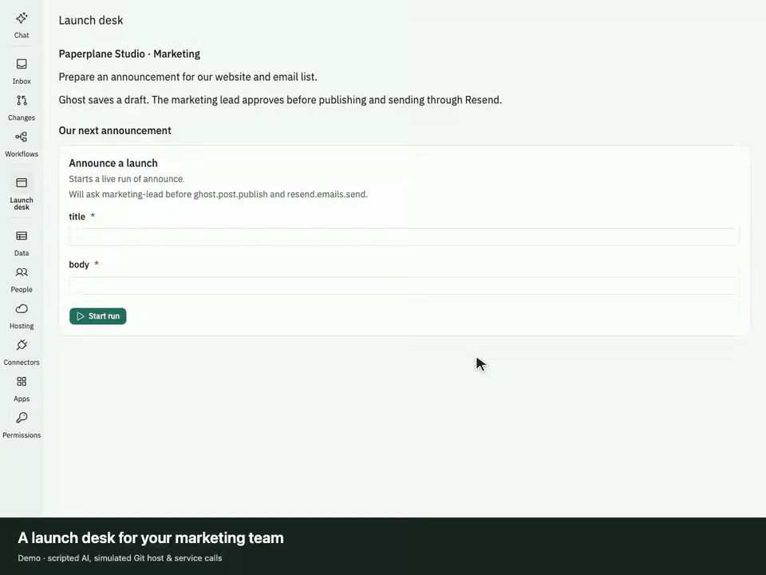
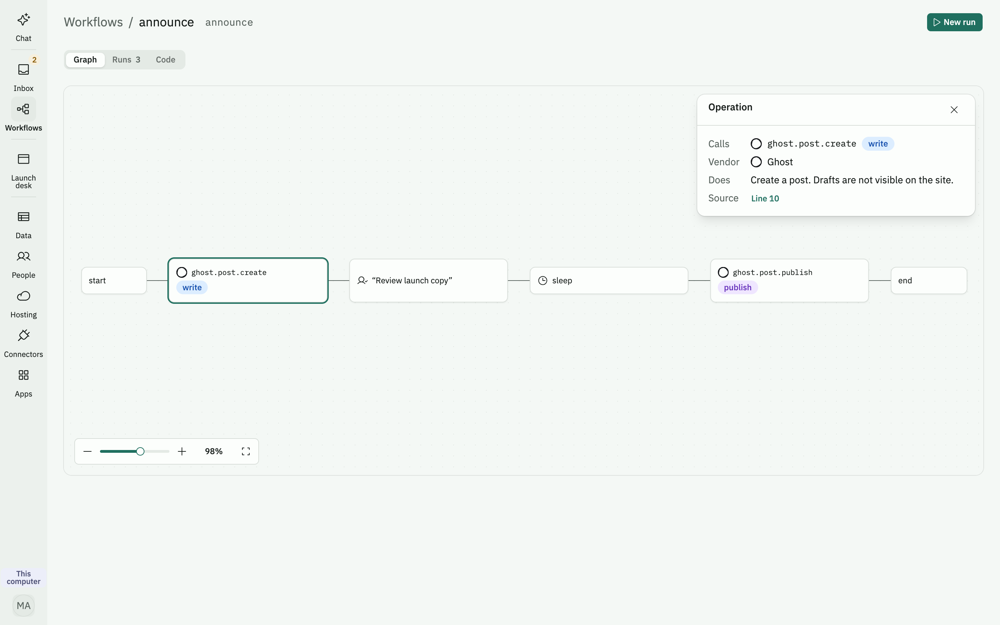
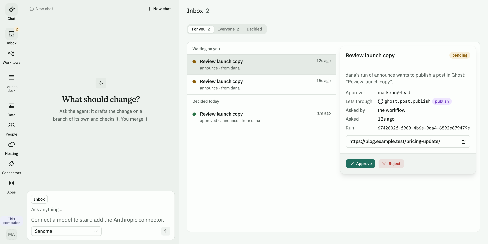
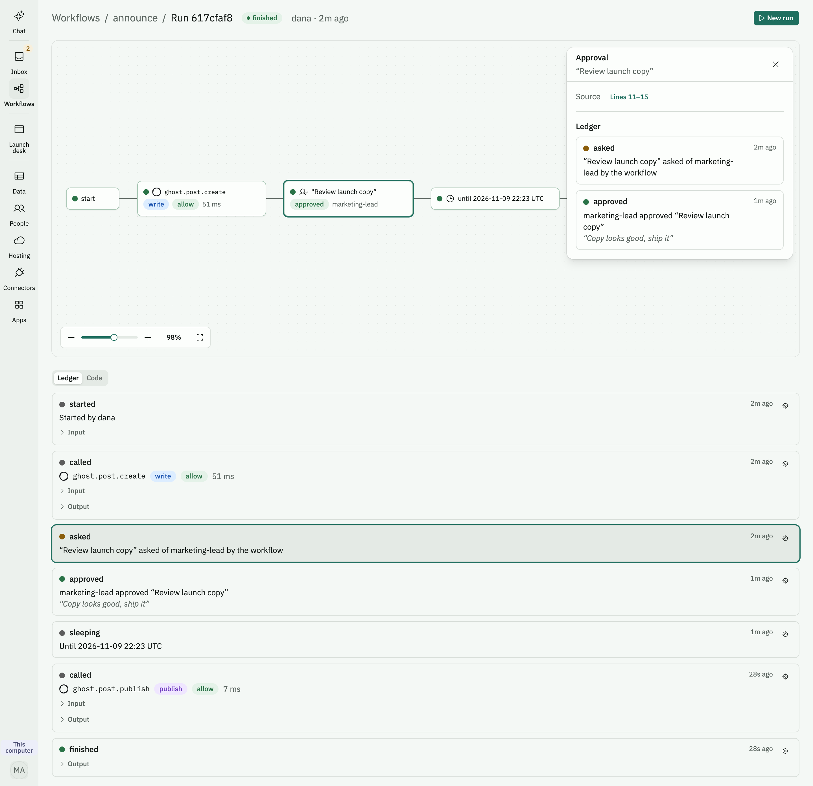

# sanoma

**A workflow and site builder for your nontechnical coworkers.**

Your coworkers describe what they need in chat. Sanoma's agent builds a draft with React pages, TypeScript workflows and data definitions in your team's Git repo. You can review the code, run tests and approve the change before it goes live.

Use the tools you already have: Claude Code with your own Claude subscription, and connectors for services such as Ghost, Resend, GitHub and Stripe. [See supported integrations and limits](#use-your-existing-tools).

Permissions control who can run each workflow and whether its connector calls are allowed, denied or held for someone's approval. Your coworkers use the pages and workflows; your team can inspect the code, permissions and record of what ran.

[Try it locally](#try-it-locally) · [Download the desktop preview](https://github.com/Sanoma-AI/sanoma/releases/latest) · [See a workflow](#what-a-workflow-looks-like) · [Documentation](packages/sanoma/README.md)

Sanoma is early and [fair source under FSL-1.1-ALv2](#license). You can read the source and host it yourself.



A launch desk from request to reviewed code, then an announcement approved for Ghost and Resend. This repeatable demo uses scripted AI and simulated Git hosting and service calls; the file edits, checks and approvals run through Sanoma. The Claude Code selector shows an available choice, not a recorded Claude session. [How the demo is recorded →](scripts/readme-shots/README.md#the-intro)

## Try it locally

### Desktop

Download for [Apple silicon](https://github.com/Sanoma-AI/sanoma/releases/latest/download/Sanoma-mac-arm64.dmg), [Intel Mac](https://github.com/Sanoma-AI/sanoma/releases/latest/download/Sanoma-mac-x64.dmg), or [Windows x64](https://github.com/Sanoma-AI/sanoma/releases/latest/download/Sanoma-windows-x64.exe). Install Sanoma, open it and choose **New company…** to create a folder for your team's code and data. You can also open an existing company folder.

The app includes Node and pnpm. It needs Git and a Git name and email configured on your machine. macOS offers Apple's command line tools when Git first runs; on Windows, install Git for Windows. Use a folder outside iCloud Drive, OneDrive or Dropbox because it holds a running database.

The desktop app is a preview. On Windows, the provider bridge is unavailable, so resources and Go live do not work, and the agent expects a POSIX shell. See [desktop details](#desktop-preview) and [known limitations](packages/desktop/README.md#what-it-does).

### Command line

With **Node 26 or later** and **Git** installed, and `git config user.name` and `git config user.email` set:

```sh
mkdir my-team && cd my-team
npx sanoma
```

This creates a company repo, installs its packages, starts its own local Postgres database and serves the app. Open the local address printed in your terminal. You do not need Docker or a separate database for this path. See [the launcher docs](packages/sanoma/README.md#start-a-company) for setup details.

### Make your first draft

In chat, choose **Your own plan → Claude Code** to use a Claude subscription that includes Claude Code, then follow its sign-in steps. Other supported agents include Codex and Copilot. Your provider's plan and usage limits apply. Alternatively, the default Sanoma agent uses an Anthropic API key entered on its connector page, with API usage billed separately. See [AI subscriptions](#ai-subscriptions).

Try asking:

> Build an internal page where teammates can submit a request with a title, description and due date. Store the requests and show them in a list.

The agent edits a draft branch and runs checks. Inspect the draft before accepting it. To send it for review and publish from the app, connect a Git remote; a new company's policy requires an admin's approval. Without a remote, merge the draft branch by hand. [How changes are reviewed and published →](packages/sanoma/workflows/README.md#changes)

## From a coworker's request to a running tool

1. **Your coworker describes the work.** They ask for a page or workflow in chat and use the app to inspect it.
2. **The agent builds a draft.** Its changes live on a separate branch, with checks and a diff your team can review. You can also edit the repo with your own editor, Claude Code or Codex.
3. **Your team reviews and publishes.** With a remote connected, Sanoma opens a pull request and shows the changes and permissions in the app. The change policy decides who must approve publishing; new companies require an admin.
4. **People use the tool.** They fill in pages, start workflows and approve requests in the Inbox. Each run has a graph and a ledger of its calls, policy decisions and results.

Reviewing a code change and approving a workflow's action are separate decisions. You might approve a workflow once, while requiring the marketing lead to approve each post it publishes.

## Use your existing tools

### AI subscriptions

Choose a supported agent under **Your own plan** in chat to use your own account, including Claude Code, Codex or Copilot. For Claude Code, use a [Claude plan that includes Claude Code](https://support.claude.com/en/articles/11145838-use-claude-code-with-your-pro-max-or-ultra-plan). This uses your subscription under the provider's terms and usage limits. The default Sanoma agent uses an Anthropic API key instead; API billing is separate from a Claude subscription.

### Service integrations

Connectors let workflows call your existing accounts through typed operations, permissions and approvals. Support depends on the connector:

| Service                               | Available today                                                                                                     |
| ------------------------------------- | ------------------------------------------------------------------------------------------------------------------- |
| [Ghost](connectors/ghost/README.md)   | Create and publish blog posts.                                                                                      |
| [Resend](connectors/resend/README.md) | Create and send broadcasts, send individual emails, and manage a sending domain.                                    |
| [GitHub](connectors/github/README.md) | Read repository resources; Sanoma also uses a connected Git remote for draft pull requests and publishing changes.  |
| [Stripe](connectors/stripe/README.md) | Read products and webhook endpoints. Creating charges, refunds or subscriptions is not supported by this connector. |

For other services, you can [write a connector](packages/sanoma/workflows/README.md#usage) for the API operations your team needs. PostHog does not yet have a bundled connector; using its API from a workflow would require adding one. See the [full connector list](#contents) for the rest.

## What comes with Sanoma

- **Sites and data.** Build [React pages](packages/sanoma/README.md#sites) for your team or the public, with sign-in. Pages can start workflows and read [collections](packages/sanoma/workflows/README.md#collections) stored in your company's Postgres database.
- **Durable workflows.** TypeScript functions run on [DBOS](https://dbos.dev) and Postgres. Steps, approvals and scheduled waits survive a restart, and each run stays on the [code version](packages/sanoma/workflows/README.md#versions) it started with. Lint checks help keep workflows [safe to replay](packages/sanoma/workflows/README.md#keeping-workflows-replay-safe).
- **Service integrations.** Connectors provide typed operations and resources for services such as Ghost, Resend, GitHub and Stripe. Each workflow declares the operations it can call. See the [connector list](#contents) for what each supports.
- **Policies and approvals.** [Cedar policies](packages/sanoma/workflows/README.md#policies) allow a connector call, deny it or require someone's approval. Approvals appear in the Inbox; the [ledger](packages/sanoma/workflows/README.md#ledger) records calls and decisions.
- **Code your team owns.** Pages, workflows, resource declarations and policies live together in your repo. Keep using branches, tests and code review as the tools grow.

## What a workflow looks like

This workflow drafts a blog post, asks the marketing lead to approve it, then publishes at the scheduled time:

```ts
// workflows/announce.ts
import { ghost } from "@sanoma-ai/connector-ghost";
import { defineWorkflow, z } from "sanoma";

export default defineWorkflow({
  name: "announce",
  trigger: "manual",
  input: z.object({ title: z.string(), body: z.string(), launchAt: z.iso.datetime({ offset: true }) }),
  uses: [ghost.post.create, ghost.post.publish, "approval", "sleep"],
  run: async (ctx, { title, body, launchAt }) => {
    const post = await ctx.ghost.post.create({ title, html: body, status: "draft" });
    await ctx.approval("Review launch copy", {
      approver: "marketing-lead",
      covers: [ghost.post.publish],
      links: [post.url],
    });
    await ctx.sleep({ until: launchAt });
    return ctx.ghost.post.publish({ id: post.id });
  },
});
```

The app turns the workflow into a graph you can inspect before running it. Approvals appear in the Inbox, and the ledger records each call, policy decision and response. To change the workflow, edit the file. See [`sanoma/workflows`](packages/sanoma/workflows/README.md) for the full API.



Select a step to see what it does and find its source under Code.



The marketing lead's Inbox shows pending approvals, links to the drafts and the actions each approval allows. Chat with the agent in the column beside it.



After a run finishes, the graph shows the result of each step. The ledger keeps the calls, policy decisions and approval notes.

## Where it runs

Run Sanoma on your machine through the desktop app or CLI, or [host it yourself](packages/sanoma/README.md#hosting-it-yourself), including on Cloudflare with Neon. The desktop app runs the same company launcher as the CLI. To keep workflows running while your laptop is off, use a host that stays available.

Locally, the company's database lives in `.sanoma/postgres` inside its folder unless you configure another Postgres database. When self-hosting, you choose the database and host. Requests to models and connected services go to those providers; running locally does not make those calls offline. You pay for the model, vendor services and hosting you use.

## Desktop (preview)

The [desktop app](packages/desktop/README.md) lets you use Sanoma without a terminal. Open a company folder, and it starts that company's `sanoma` launcher in a window. macOS and Windows x64 preview builds are on [GitHub Releases](https://github.com/Sanoma-AI/sanoma/releases). Releases from 0.5.0 use `v*` tags; the first preview was `desktop-v0.1.0`.

Download the arm64 build (`Sanoma-<version>-arm64.dmg`) for an Apple silicon Mac or the x64 build for an Intel Mac. Drag Sanoma to Applications and open it. The builds are signed with a Developer ID and notarized by Apple, so macOS opens them without the unidentified-developer warning. See [signing](packages/desktop/README.md#signing-and-notarization) for details. On Windows, run `Sanoma-windows-x64.exe`, signed with Azure Artifact Signing. It installs for you alone and opens from the Start menu.

The app includes Node and pnpm. It also needs Git; macOS offers to install Apple's command line tools the first time Git runs, and on Windows the app asks for Git for Windows.

From version 0.5.0, Sanoma updates itself when installed in Applications, or on Windows by its installer. It downloads a new release in the background, which the next launch runs, or you can choose Help → Restart to Update. If you run it from the dmg or another location, it checks once a day and links to the release instead. Version 0.1.0 has no updater, so replace it manually once.

To release the desktop app:

1. Open a pull request that bumps `version` in [`packages/desktop/package.json`](packages/desktop/package.json) and updates [`RELEASE_NOTES.md`](packages/desktop/RELEASE_NOTES.md). The desktop version is separate from the npm package versions.
2. Merge and wait for CI on `main` to pass, then run `gh workflow run desktop-release.yml --ref main`.
3. Download the draft release in a browser and try it before publishing it as the latest release.

[`desktop-release.yml`](.github/workflows/desktop-release.yml) builds arm64 and x64 dmg and zip files on a macOS runner, signs and notarizes them, and builds and signs the Windows x64 installer on a Windows runner. Once both pass their checks, it uploads them to one draft release tagged `v<version>`. It also uploads each dmg as `Sanoma-mac-<arch>.dmg` and the installer as `Sanoma-windows-x64.exe`. The website's download buttons use those stable filenames through GitHub's `releases/latest/download/` URL.

Publishing the release makes it available to installed apps through [update.electronjs.org](https://github.com/electron/update.electronjs.org). The service offers the newest release with a semver tag that is neither a draft nor a prerelease. Each Mac architecture needs a `-darwin-<arch>` zip, named `Sanoma-darwin-<arch>-<version>.zip` by Forge. Windows x64 needs an asset named `-win32-x64` (`Sanoma-<version>-win32-x64-Setup.exe`), `RELEASES`, and the nupkg that names (`Sanoma-<version>-full.nupkg`).

The `v*` tags and releases belong to the desktop app; npm releases create none. Older npm releases used `v0.2.0` through `v0.4.2`, which is why desktop versions resume at 0.5.0. The release workflow requires a version newer than every existing `v*` tag.

## Develop

Install Node 26 or later, pnpm, and Docker for the workflow tests. If you use [mise](https://mise.jdx.dev), run `mise install` to set up Node and pnpm from `.mise.toml`.

```sh
pnpm install
pnpm db:up          # Postgres for DBOS on port 5433
pnpm test           # vitest, runs against the TypeScript sources
pnpm typecheck
pnpm lint && pnpm format:check
pnpm build          # compiles each package to dist/ for publishing
```

Inside the repo, `sanoma/*` and `@sanoma-ai/*` imports resolve to the sources through `tsconfig.json` paths and `vitest.config.ts` aliases. You can run tests and typechecks without building first. Published packages ship compiled code in `dist/` (each part of `sanoma` its own, such as `workflows/dist`); `sanoma/workflows` also ships its `src/` for its source maps.

To try an unpublished change in your own Sanoma repo, link this checkout with [`sanoma dev link`](packages/sanoma/dev/README.md). Run `sanoma dev unlink` before committing.

## Release

[`release.yml`](.github/workflows/release.yml) publishes `sanoma` and the `@sanoma-ai/*` packages to npm using [trusted publishing](https://docs.npmjs.com/trusted-publishers), without an npm token. The connectors carry `sanoma`'s version and are released with it; the platform binaries (`@sanoma-ai/bridge-*`, `@sanoma-ai/postgres-*`) keep versions of their own. A release publishes versions that are not already on npm.

### Prepare the versions

Open a pull request that bumps `version` in `packages/sanoma/package.json` and every public connector's `package.json` to the same new version, and a platform binary's when its shipped contents have changed. Private packages, such as `@sanoma-ai/desktop`, do not need a release version. Put the release notes in the PR description.

- A breaking change in a 0.x package requires a minor version bump.
- A provider-bridge release (`RELEASE` in `packages/sanoma/bridge/scripts/download-bridge.ts`) requires new versions of the `@sanoma-ai/bridge-<platform>` packages. A PostgreSQL release (`RELEASE` in `packages/sanoma/scripts/download-postgres.ts`) requires new versions of the `@sanoma-ai/postgres-<platform>` packages.
- `sanoma`'s `devDependencies` on the connectors its template names set the versions a new company starts from, as the workspace has them when `sanoma` is published. For a connector's release to reach new companies, release `sanoma` too; the release check does not ask for it.
- Bump dependent packages when their published dependency ranges exclude the new version. This includes exact pins (`workspace:*`, used by `sanoma` for the runtime and by `sanoma/internal/bridge` for its binaries) and peer ranges after a minor bump (`workspace:^`, published as `^` on the version at that time).

Run `node scripts/release-check.ts` to find packages that still need a bump, including dependencies that pin other bumped packages. The release workflow runs this check first. It also reports packages missing from npm and public packages whose shipped inputs differ from the commit that set their version. Tests, `AGENTS.md` and manifest-only `devDependencies` changes are excluded. Historical commits alone do not require a bump if the shipped inputs are unchanged.

To inspect a package's history since its version was last set, use the command below. This log does not replace the release check.

```sh
dir=connectors/ghost; git log --oneline "$(git log -1 --format=%H -G'"version":' -- "$dir/package.json")".. -- "$dir"
```

### Publish the release

Merge the PR and wait for CI on `main` to pass. Create a `release/<version>` branch at the merge commit, using a name that has not been used before, such as the new `sanoma` version. Run the workflow on that branch:

```sh
git push origin <sha>:refs/heads/release/<version>
gh workflow run release.yml --ref release/<version>   # or Actions → Release → Run workflow
```

The workflow requires a `release/*` branch, a commit on `main` with passing CI, and a passing release check. Its job summary lists the commit and versions it will publish. It runs `pnpm publish -r` in dependency order and skips versions already on npm.

If one package fails to publish, publishing stops. Check the publish log to see which versions reached npm, fix the failure and rerun the workflow on the same branch. It publishes the remaining versions from the same commit. Changing a package that is already public requires a new version.

After the release succeeds, delete the branch with `git push origin --delete release/<version>`.

### Set up a new package

A new public package starts at its own version (`0.1.0`) and declares its `@sanoma-ai/*` peer dependencies as `workspace:^`. No change to `release.yml` or a package list is needed: `pnpm publish -r` includes every workspace package that is not private.

Publish the package by hand on the day it merges, then configure its trusted publisher on npmjs.com. npm requires the package to exist before adding a trusted publisher. A new publisher configuration expires unless first used within two days.

An owner of the `sanoma-ai` npm organization sets this up once per package. Under Settings → Trusted publishing → GitHub Actions, use:

| Setting            | Value         |
| ------------------ | ------------- |
| Owner              | `Sanoma-AI`   |
| Repository         | `sanoma`      |
| Workflow           | `release.yml` |
| Allow npm publish  | On            |
| Allow npm dist-tag | Off           |

Set the package's Publishing access to "Require two-factor authentication and disallow tokens." A trusted publisher does not use a token.

### Publish by hand

For a first publish or a manual fallback, start from a clean checkout of the merge commit. Log in as a member of the npm organization with `npm login --auth-type=web`.

Pack with pnpm so prepack runs and the tarball includes the resolved `workspace:` ranges and `publishConfig`. Then publish the tarball with npm in your own terminal, where it prompts for 2FA. Direct `pnpm publish` fails with E404 under pnpm 11 (sanoma #343).

```sh
pnpm install --frozen-lockfile
node scripts/release-check.ts   # a fallback only
pnpm build                      # packages already public skip prepack, and their dependents build against them
pnpm --filter <name> pack --pack-destination "$TMPDIR"
npm publish "$TMPDIR"/<file>.tgz --access public
```

### Publish the runtime image

Container hosts use the public [runtime image](packages/sanoma/README.md#hosting-it-yourself) at [`ghcr.io/sanoma-ai/runtime`](https://github.com/orgs/Sanoma-AI/packages/container/package/runtime). It has one linux/amd64 manifest and is tagged with the `sanoma` version, never `latest`.

After the npm packages publish, `release.yml` pushes the image if its tag is missing. Its pnpm store is filled from npm with the packages that release published (`scripts/runtime-packages.ts`), so the image is built only after them; the hand command below takes the same list. It uses the job's `GITHUB_TOKEN` with `packages: write`; the registry package was made public manually in GitHub's settings. Tags are never replaced, so changes to `packages/sanoma/runtime/` require a new `sanoma` version.

The image build checks its embedded bridge's session protocol independently of npm publication. Runtime `0.10.1` contains an incompatible older bridge. Skip it and use the corrected `0.10.2` image once published.

To publish manually, run `docker login ghcr.io` and check for the tag with `docker buildx imagetools inspect ghcr.io/sanoma-ai/runtime:<version>`. If the tag does not exist, build and push it:

```sh
docker buildx build --platform linux/amd64 --provenance=false --build-arg PACKAGES="$(node scripts/runtime-packages.ts)" -t ghcr.io/sanoma-ai/runtime:<version> --push packages/sanoma/runtime
```

Cloudflare containers use an image in the account's own registry. Apply copies it there from ghcr.io; see [the connector](connectors/cloudflare/README.md#the-image). To upload it manually, build and push with Wrangler:

```sh
docker build --platform linux/amd64 --build-arg PACKAGES="$(node scripts/runtime-packages.ts)" -t sanoma-runtime:<version> packages/sanoma/runtime
npx wrangler containers push sanoma-runtime:<version>
```

Declare the image reference Wrangler prints (`registry.cloudflare.com/<account id>/sanoma-runtime:<version>`). Apply uses that reference directly.

On Cloudflare, the company's Worker serves public sites on their own domains without a login. Pages are prerendered or rendered on the Worker using the company's database. A page only wakes the container when it starts a workflow run. See [public sites on the Worker](connectors/cloudflare/README.md#the-worker).

The container's worker builds the app bundle for a deploy's revision, in a checkout of its own (`GET /__sanoma/app-bundle?revision=<commit>`, [the worker's port](packages/sanoma/README.md#the-workers-port)), using `buildAppBundle` from `sanoma/app/bundle`. The build needs `workerd`, which `sanoma/app` installs alongside `wrangler` and `@cloudflare/vite-plugin`.

## License

Sanoma is **fair source**, not open source: [Functional Source License 1.1, Apache 2.0 future license](LICENSE) (FSL-1.1-ALv2). You may use, modify and self-host Sanoma for any purpose except offering it as a competing commercial product or service. Each version becomes available under Apache-2.0 two years after its release.

## Contributing

For repository maintenance, start with [AGENTS.md](AGENTS.md) and follow only the relevant package guide.

Contributions are accepted under the [Developer Certificate of Origin](https://developercertificate.org/) (DCO). Sign off every commit with `git commit -s`. See the org-wide contributing guide, code of conduct and security policy in [`Sanoma-AI/.github`](https://github.com/Sanoma-AI/.github).

## Contents

| Path                                                                     | What it is                                                                                                                            |
| ------------------------------------------------------------------------ | ------------------------------------------------------------------------------------------------------------------------------------- |
| [`packages/`](packages/AGENTS.md)                                        | Core workspace packages                                                                                                               |
| [`sanoma`](packages/sanoma/README.md)                                    | The bin a company repo runs, checks and exports itself with; what its workflows import                                                |
| [`sanoma/workflows`](packages/sanoma/workflows/README.md)                | Define connectors and workflows, run them durably on DBOS, and lint them                                                              |
| [`sanoma/app`](packages/sanoma/app/README.md)                            | Web UI over a config, started with `startApp(config)`                                                                                 |
| [`@sanoma-ai/invoices`](packages/invoices/README.md)                     | Shared invoice validation, exact calculations, industry adapters and React PDF rendering (private)                                    |
| [`sanoma/testing`](packages/sanoma/testing/README.md)                    | `startTestWorker`, `testDatabaseUrl`, a vitest test app, vendor replay, and scenario testing                                          |
| [`sanoma/internal/bridge`](packages/sanoma/bridge/README.md)             | OpenTofu providers: the provider-bridge client, its fake, the resource generator                                                      |
| [`@sanoma-ai/desktop`](packages/desktop/README.md)                       | The desktop shell (private): runs a company folder's own launcher and shows the app                                                   |
| [`connectors/`](connectors/AGENTS.md)                                    | Vendor connectors, one workspace package each                                                                                         |
| [`@sanoma-ai/connector-invoices`](connectors/invoices/README.md)         | Local invoice PDF generation for workflows (private)                                                                                  |
| [`@sanoma-ai/connector-gcp`](connectors/gcp/README.md)                   | Google Cloud KMS/IAM resources through explicit workload identity and isolated provider sessions                                      |
| [`@sanoma-ai/connector-ghost`](connectors/ghost/README.md)               | Ghost Admin API post operations and an in-memory fake                                                                                 |
| [`@sanoma-ai/connector-resend`](connectors/resend/README.md)             | Resend broadcast and email operations, the sending domain as a resource, and an in-memory fake                                        |
| [`@sanoma-ai/connector-exa`](connectors/exa/README.md)                   | Exa web search, page contents, similar pages and answers, and an in-memory fake                                                       |
| [`@sanoma-ai/connector-bluesky`](connectors/bluesky/README.md)           | Bluesky post operations and an in-memory fake                                                                                         |
| [`@sanoma-ai/connector-cloudflare`](connectors/cloudflare/README.md)     | Cloudflare: a Container host that stops when quiet, its public sites on the Worker, the alarm that wakes it, and a zone's DNS records |
| [`@sanoma-ai/connector-docker`](connectors/docker/README.md)             | The local Docker host: a container that runs the company, through its OpenTofu provider                                               |
| [`@sanoma-ai/connector-github`](connectors/github/README.md)             | GitHub resources read through its OpenTofu provider, a replay fake, and Copilot for the chat                                          |
| [`@sanoma-ai/connector-stripe`](connectors/stripe/README.md)             | Stripe resources read through its OpenTofu provider, and a replay fake                                                                |
| [`@sanoma-ai/connector-supabase`](connectors/supabase/README.md)         | Supabase projects read through its OpenTofu provider, and a replay fake                                                               |
| [`@sanoma-ai/connector-neon`](connectors/neon/README.md)                 | Neon projects, the company's database that pauses and branches, and an in-memory fake                                                 |
| [`@sanoma-ai/connector-sanoma-cloud`](connectors/sanoma-cloud/README.md) | Sanoma Cloud: the company's database and host in Sanoma's accounts, over sanoma-ops's workflows                                       |
| [`sanoma/better-auth`](packages/sanoma/better-auth/README.md)            | Better Auth, the visitor login for public sites and the staff sign-in on a host, on the company's database                            |
| [`@sanoma-ai/connector-anthropic`](connectors/anthropic/README.md)       | Anthropic's Claude models for the app's agent, through the AI SDK, and Claude Code for the chat                                       |
| [`@sanoma-ai/connector-openai`](connectors/openai/README.md)             | Codex, OpenAI's coding agent, for the chat on a person's own plan                                                                     |
| [`@sanoma-ai/connector-opencode`](connectors/opencode/README.md)         | OpenCode, a coding agent for the chat on a person's own plan                                                                          |
| [`@sanoma-ai/connector-pi`](connectors/pi/README.md)                     | Pi, a coding agent for the chat on a person's own plan or the company's Anthropic key                                                 |
| [`@sanoma-ai/connector-agent37`](connectors/agent37/README.md)           | Agent37 instances, the boxes coding agents work in, driven through Sanoma's runner                                                    |
| [`modules/`](modules/AGENTS.md)                                          | Placeholder for parts not written yet                                                                                                 |
| [`types/`](types/AGENTS.md)                                              | Ambient type declarations shared by the packages                                                                                      |
| [`.github/`](.github/AGENTS.md)                                          | GitHub Actions CI and the README's images                                                                                             |
| [`.claude/`](.claude/)                                                   | Agent skills for Claude Code                                                                                                          |
| [`.agents/`](.agents/)                                                   | Vendored agent skills                                                                                                                 |
| [`package.json`](package.json)                                           | Root scripts: checks, build, test, `db:up`, `bridge:download`, `postgres:download`                                                    |
| [`tsconfig.json`](tsconfig.json)                                         | Root TypeScript config: `sanoma`'s shipped options, with `@sanoma-ai/*` paths to each `src/`                                          |
| [`vitest.config.ts`](vitest.config.ts)                                   | Test config with aliases to the package sources                                                                                       |
| [`docker-compose.yml`](docker-compose.yml)                               | Postgres for DBOS on port 5433                                                                                                        |
| [`lefthook.yml`](lefthook.yml)                                           | Pre-commit format and lint on staged files                                                                                            |
| [`.oxlintrc.json`](.oxlintrc.json)                                       | Lint config                                                                                                                           |
| [`.oxfmtrc.json`](.oxfmtrc.json)                                         | Format config                                                                                                                         |
| [`pnpm-workspace.yaml`](pnpm-workspace.yaml)                             | Workspace globs: `packages/*` and `connectors/*`                                                                                      |
| [`skills-lock.json`](skills-lock.json)                                   | Lock file for installed agent skills                                                                                                  |

Connectors live here under `connectors/`; one moves to its own repo only when someone outside the team maintains it.
