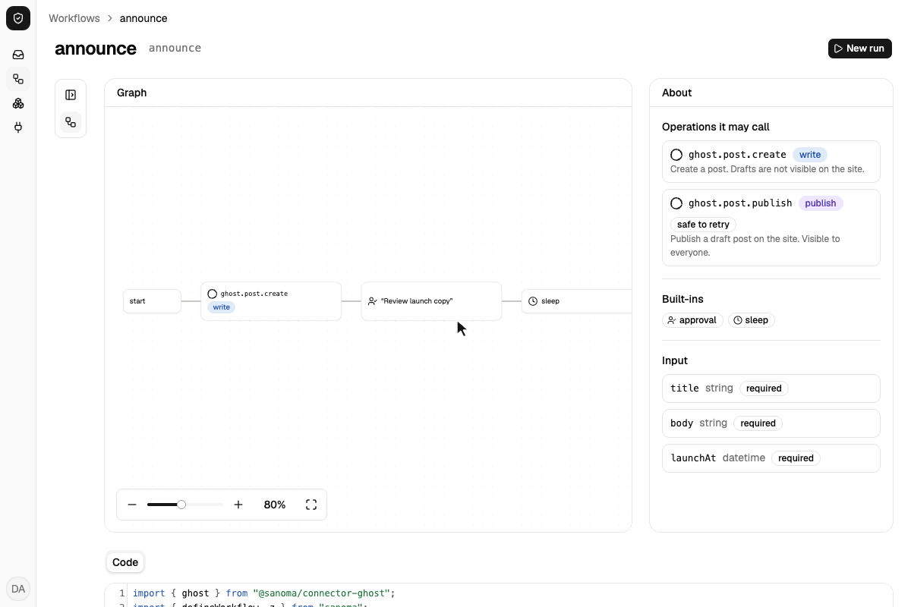
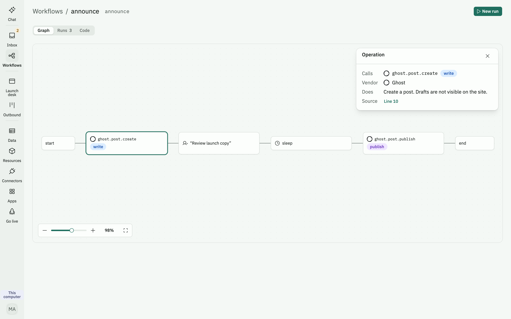
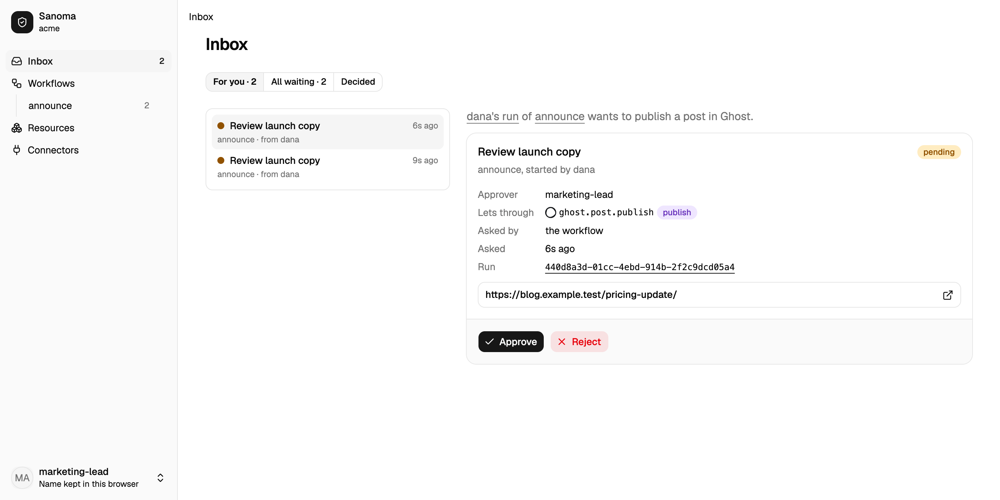
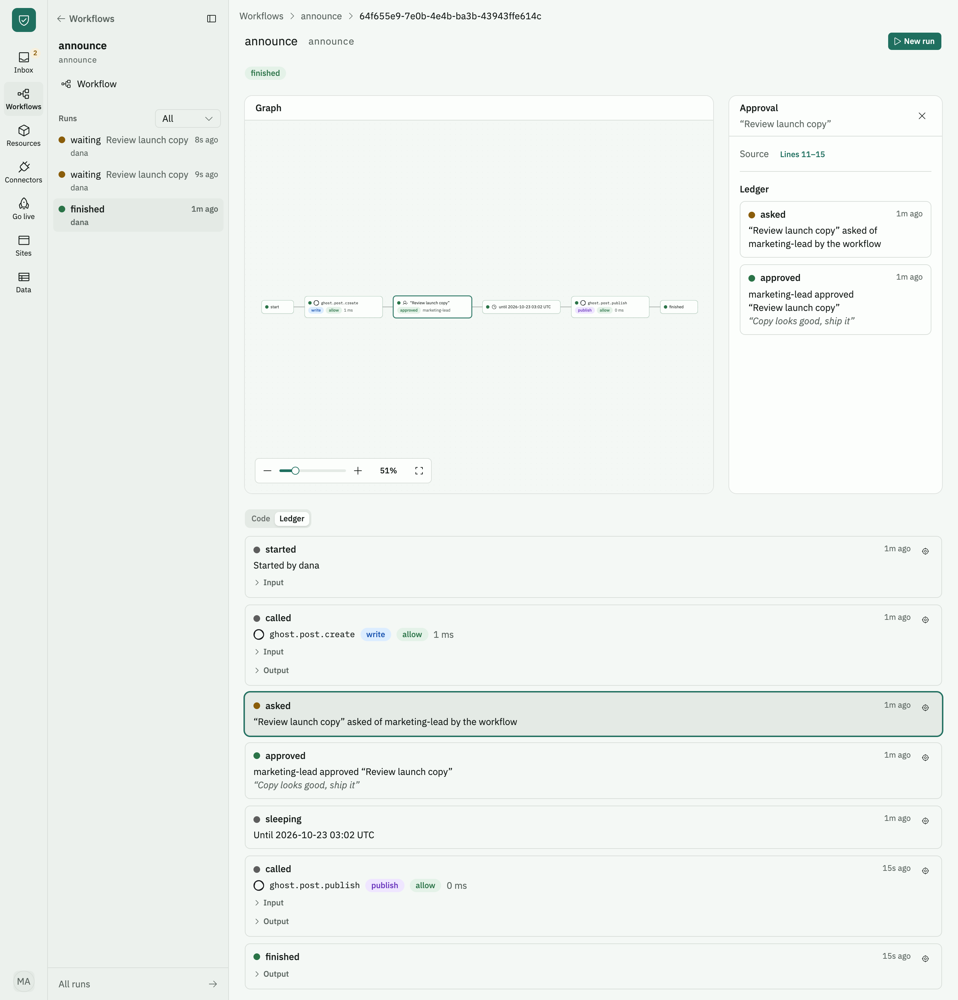

# sanoma

Sanoma runs the everyday admin of a small business: the emails, posts, web pages and records it relies on. You tell it in plain words how your business works, an AI agent writes the code, and you see each change before it goes live. Before Sanoma sends or publishes anything, it checks the rules you set, and anything you marked as needing a yes waits for one. It keeps a record of everything it did.

All of it is ordinary TypeScript in a repo your business owns, so any developer can read it, change it or move it elsewhere. This repo holds the code that runs it, the app you work in, and the integrations with other services, and you can run all of it yourself.

The agent can be ours, or a coding agent you already pay for: Claude Code, Codex, Copilot, OpenCode or Pi. Either way it works on a separate copy, and your business only changes when you accept it ([the chat](packages/app/README.md)).

Status: early. Workflows run on [DBOS](https://dbos.dev) with Postgres: each vendor call is a durable step, approvals and sleeps survive restarts, and a lint keeps workflow code safe to replay. Before every vendor call and run start a policy, written in [Cedar](https://docs.cedarpolicy.com) in the repo, lets it through, denies it or holds it for an approver, as the people the repo declares, and a ledger records each run: who started it, every call with the policy's decision and the vendor's reply, every approval, and how it ended. Versioning is automatic: each run is stamped with a hash of the workflow code it started on, and only a worker on that version resumes it (`DBOS__APPVERSION` names a version instead; see [Versions](packages/workflows/README.md#versions)). The connectors so far are listed under [Contents](#contents); keeping a company's vendor settings (card limits, time-off policies, access in tools like Mercury, Gusto and Okta) in typed files is where it is headed, not what it does today.



A run of the workflow below: dana starts it, marketing-lead approves the copy, and it sleeps until a launch time a minute away, then publishes. For the recording Ghost is answered by its in-memory fake, though the form still shows Live vendors and "Calls Ghost for real".

## What a workflow looks like

A company repo holds `sanoma.config.ts` with `workflows/`, `policies/` (Cedar) and `resources/` (its people among them) beside it, and the [`sanoma`](packages/sanoma/README.md) bin runs its workflows and the app. A workflow lists the vendor operations it may call, and can call nothing else. This one drafts a blog post, waits for the marketing lead, sleeps until launch, then publishes:

```ts
// workflows/announce.ts
import { ghost } from "@sanoma-ai/connector-ghost";
import { defineWorkflow, z } from "sanoma";

export default defineWorkflow({
  name: "announce",
  trigger: "manual",
  input: z.object({ title: z.string(), body: z.string(), launchAt: z.iso.datetime({ offset: true }) }),
  uses: [ghost.post.create, ghost.post.publish, "approval", "sleep"],
  run: async (ctx, { title, body, launchAt }) => {
    const post = await ctx.ghost.post.create({ title, html: body, status: "draft" });
    await ctx.approval("Review launch copy", {
      approver: "marketing-lead",
      covers: [ghost.post.publish],
      links: [post.url],
    });
    await ctx.sleep({ until: launchAt });
    return ctx.ghost.post.publish({ id: post.id });
  },
});
```

The app draws this file as a graph before it runs, lists the approval in its Inbox, and shows each run's calls, decisions and replies in its ledger. A developer changes the workflow by changing the file. [`@sanoma-ai/workflows`](packages/workflows/README.md) has the whole API.



The workflow's page: the graph is drawn from the file, and picking a step says what it does and finds its lines under Code.



The Inbox as marketing-lead: the approvals waiting for them, with the draft's link and what approving lets through. Beside it is the chat, where you ask the agent for a change and it shows you the edit to accept.



A finished run: the graph shows how each step went, and the ledger records each call with the policy's decision and the approval with its note.

## Solved in public

We're building Sanoma in public. Each time, we take a problem a small business owner posted about online and solve it with Sanoma, showing the code, the rules we set and what still needed a person. Each write-up gets a row here.

| Problem | Who has it | What we built | Write-up |
| ------- | ---------- | ------------- | -------- |

The first one is in progress.

## Contents

| Path                                                                   | What it is                                                                                    |
| ---------------------------------------------------------------------- | --------------------------------------------------------------------------------------------- |
| [`packages/`](packages/AGENTS.md)                                      | Core workspace packages                                                                       |
| [`sanoma`](packages/sanoma/README.md)                                  | The bin a company repo runs, checks and exports itself with; what its workflows import        |
| [`@sanoma-ai/workflows`](packages/workflows/README.md)                 | Define connectors and workflows, run them durably on DBOS, and lint them                      |
| [`@sanoma-ai/app`](packages/app/README.md)                             | Web UI over a config, started with `startApp(config)`                                         |
| [`@sanoma-ai/testing`](packages/testing/README.md)                     | `startTestWorker`, `testDatabaseUrl`, a vitest test app, vendor replay, and scenario testing  |
| [`@sanoma-ai/bridge`](packages/bridge/README.md)                       | OpenTofu providers: the provider-bridge client, its fake, the resource generator              |
| [`@sanoma-ai/desktop`](packages/desktop/README.md)                     | The desktop shell (private): runs a company folder's own launcher and shows the app           |
| [`connectors/`](connectors/AGENTS.md)                                  | Vendor connectors, one workspace package each                                                 |
| [`@sanoma-ai/connector-ghost`](connectors/ghost/README.md)             | Ghost Admin API post operations and an in-memory fake                                         |
| [`@sanoma-ai/connector-resend`](connectors/resend/README.md)           | Resend broadcast and email operations and an in-memory fake                                   |
| [`@sanoma-ai/connector-exa`](connectors/exa/README.md)                 | Exa web search, page contents, similar pages and answers, and an in-memory fake               |
| [`@sanoma-ai/connector-bluesky`](connectors/bluesky/README.md)         | Bluesky post operations and an in-memory fake                                                 |
| [`@sanoma-ai/connector-cloudflare`](connectors/cloudflare/README.md)   | Cloudflare Containers: a host that stops when quiet, and a Durable Object alarm that wakes it |
| [`@sanoma-ai/connector-docker`](connectors/docker/README.md)           | The local Docker host: a container that runs the company, through its OpenTofu provider       |
| [`@sanoma-ai/connector-github`](connectors/github/README.md)           | GitHub resources read through its OpenTofu provider, and a replay fake                        |
| [`@sanoma-ai/connector-stripe`](connectors/stripe/README.md)           | Stripe resources read through its OpenTofu provider, and a replay fake                        |
| [`@sanoma-ai/connector-supabase`](connectors/supabase/README.md)       | Supabase projects read through its OpenTofu provider, and a replay fake                       |
| [`@sanoma-ai/connector-neon`](connectors/neon/README.md)               | Neon projects, the company's database that pauses and branches, and an in-memory fake         |
| [`@sanoma-ai/connector-better-auth`](connectors/better-auth/README.md) | Better Auth, a visitor login for public sites, on the company's database                      |
| [`@sanoma-ai/connector-anthropic`](connectors/anthropic/README.md)     | Anthropic's Claude models for the app's agent, through the AI SDK                             |
| [`modules/`](modules/AGENTS.md)                                        | Placeholder for parts not written yet                                                         |
| [`types/`](types/AGENTS.md)                                            | Ambient type declarations shared by the packages                                              |
| [`.github/`](.github/AGENTS.md)                                        | GitHub Actions CI and the README's images                                                     |
| [`.claude/`](.claude/)                                                 | Agent skills for Claude Code                                                                  |
| [`.agents/`](.agents/)                                                 | Vendored agent skills                                                                         |
| [`package.json`](package.json)                                         | Root scripts: checks, build, test, `db:up`, `bridge:download`, `postgres:download`            |
| [`tsconfig.json`](tsconfig.json)                                       | Root TypeScript config: `sanoma`'s shipped options, with `@sanoma-ai/*` paths to each `src/`  |
| [`vitest.config.ts`](vitest.config.ts)                                 | Test config with aliases to the package sources                                               |
| [`docker-compose.yml`](docker-compose.yml)                             | Postgres for DBOS on port 5433                                                                |
| [`lefthook.yml`](lefthook.yml)                                         | Pre-commit format and lint on staged files                                                    |
| [`.oxlintrc.json`](.oxlintrc.json)                                     | Lint config                                                                                   |
| [`.oxfmtrc.json`](.oxfmtrc.json)                                       | Format config                                                                                 |
| [`pnpm-workspace.yaml`](pnpm-workspace.yaml)                           | Workspace globs: `packages/*` and `connectors/*`                                              |
| [`skills-lock.json`](skills-lock.json)                                 | Lock file for installed agent skills                                                          |

Connectors live here under `connectors/`; one moves to its own repo only when someone outside the team maintains it.

## Desktop (preview)

The [desktop app](packages/desktop/README.md) opens a company folder, runs that company's own `sanoma` launcher and shows the app in a window, for people who will not open a terminal. Its macOS preview builds are released on [GitHub Releases](https://github.com/Sanoma-AI/sanoma/releases) as `desktop-v*`, the first being 0.1.0.

1. Download the arm64 build (`Sanoma-<version>-arm64.dmg`) on an Apple silicon Mac, or the x64 one on an Intel Mac, and drag Sanoma to Applications.
2. The builds are not signed by Apple yet, so the first open is blocked: open Sanoma, dismiss the warning, then go to System Settings → Privacy & Security and click "Open Anyway" next to the message about Sanoma (on macOS 15 and later, Control-click → Open no longer gets past it).
3. If "Open Anyway" does not appear, run `xattr -dr com.apple.quarantine /Applications/Sanoma.app` in Terminal instead.

The app needs nothing else installed: it ships the Node and the pnpm it runs a company with. git comes with Apple's command line tools, which macOS offers to install the first time `git` runs. It does not update itself: once a day it checks for a newer release and links to it (Help → Check for a Newer Sanoma).

To release it, bump `version` in [`packages/desktop/package.json`](packages/desktop/package.json) (its own version line, apart from npm's) and the notes in [`RELEASE_NOTES.md`](packages/desktop/RELEASE_NOTES.md) in a pull request, merge, wait for CI on `main`, then run `gh workflow run desktop-release.yml --ref main`. [`desktop-release.yml`](.github/workflows/desktop-release.yml) builds the arm64 and x64 dmg and zip on a macOS runner and uploads them to a draft release `desktop-v<version>`; download it in a browser, try it, then publish the draft.

## Develop

Needs Node 26 or later, pnpm, and Docker for the workflow tests. With [mise](https://mise.jdx.dev), `mise install` sets up Node and pnpm from `.mise.toml`.

```sh
pnpm install
pnpm db:up          # Postgres for DBOS on port 5433
pnpm test           # vitest, runs against the TypeScript sources
pnpm typecheck
pnpm lint && pnpm format:check
pnpm build          # compiles each package to dist/ for publishing
```

Inside the repo, `@sanoma-ai/*` imports resolve to each package's `src/` (via `paths` in `tsconfig.json` and aliases in `vitest.config.ts`), so tests and typechecks need no build. Published packages ship the compiled `dist/`, not the sources (`@sanoma-ai/workflows` also ships `src/`, which its source maps point at).

To dogfood a change from a Sanoma repo of your own before it is published, link this checkout into it with [`@sanoma-ai/dev`](packages/dev/README.md) (`sanoma-dev link`, and `sanoma-dev unlink` before a commit).

## Release

[`release.yml`](.github/workflows/release.yml) publishes `sanoma` and the `@sanoma-ai/*` packages to npm with [trusted publishing](https://docs.npmjs.com/trusted-publishers) (no npm token). Each package has its own version, and a release ships only the packages whose version changed. To release:

1. In a pull request, bump `version` in the `package.json` of each public package that changed since its last release (not a private one, such as `@sanoma-ai/testing`); a breaking change in a 0.x package is a minor bump, and a provider-bridge release (`RELEASE` in `packages/bridge/scripts/download-bridge.ts`) is a change to the `@sanoma-ai/bridge-<platform>` packages, as a PostgreSQL release (`RELEASE` in `packages/sanoma/scripts/download-postgres.ts`) is to the `@sanoma-ai/postgres-<platform>` packages. Packages that depend on one you bumped need a new version too when their published range leaves the new one out: an exact pin (`workspace:*`, as `sanoma` pins the runtime and `@sanoma-ai/bridge` its binaries), or a peer range (`workspace:^`, published as `^` on the version at that time) after a minor bump. `node scripts/release-check.ts` names each one it finds, counting the ones that pin those in turn, and the workflow runs it first. It also names a public version whose source has changed since (the `git log` below, less tests and `AGENTS.md` files), which needs a new version too, and a package npm does not have yet. The pull request's description carries the release notes. What changed in a package since the commit that last set its version:

   ```sh
   dir=connectors/ghost; git log --oneline "$(git log -1 --format=%H -G'"version":' -- "$dir/package.json")".. -- "$dir"
   ```

2. Merge, wait for CI on `main` to pass, then push a `release/<version>` branch at the merge commit (a name not used before, such as the new `sanoma` version) and run the workflow on it, never on `main`:

```sh
git push origin <sha>:refs/heads/release/<version>
gh workflow run release.yml --ref release/<version>   # or Actions → Release → Run workflow
```

The workflow fails on a ref not named `release/*`, if the commit is not on `main` or its CI did not pass, or if the check above names a package. Its job summary names the commit and the versions it will publish, each package whose version is not yet on npm (`pnpm publish -r`, in dependency order). The first package that fails to publish stops the rest: the publish step's log shows what went public. Fix what failed and run the workflow again on the same branch, which skips versions already public and publishes the rest from the same commit (a fix in a package already public needs a new version). Then delete the branch: `git push origin --delete release/<version>`.

Each package needs a trusted publisher on npmjs.com, added once by an owner of the `sanoma-ai` organization under the package's Settings → Trusted publishing → GitHub Actions: owner `Sanoma-AI`, repository `sanoma`, workflow `release.yml`, with "Allow npm publish" on (not "Allow npm dist-tag"), and the package's Publishing access set to "Require two-factor authentication and disallow tokens" (a trusted publisher is not a token). A new package, such as a connector under `connectors/`, needs no change to `release.yml` or any list (`pnpm publish -r` takes every workspace package that is not `private`): it starts at a version of its own (`0.1.0`) and names the `@sanoma-ai/*` packages it peers on as `workspace:^`. npm adds a trusted publisher only to a package that already exists, and the workflow stops at the first package it cannot publish, so a new package is published once by hand on the day it merges, and its trusted publisher set then (a new configuration expires unless it is first used within two days).

By hand, as that first publish or as a fallback, from a clean checkout of the merge commit and logged in to npm as a member of the organization (`npm login --auth-type=web`): pack with pnpm, which runs the prepack and writes the `workspace:` ranges and `publishConfig` into the tarball, then publish the tarball with npm in your own terminal, which asks for the 2FA. `pnpm publish` fails there with E404 under pnpm 11 (sanoma #343).

```sh
pnpm install --frozen-lockfile
node scripts/release-check.ts   # a fallback only
pnpm build                      # packages already public skip prepack, and their dependents build against them
pnpm --filter <name> pack --pack-destination "$TMPDIR"
npm publish "$TMPDIR"/<file>.tgz --access public
```

The [runtime image](packages/sanoma/README.md#hosting-it-yourself) a container host runs is [`ghcr.io/sanoma-ai/runtime`](https://github.com/orgs/Sanoma-AI/packages/container/package/runtime) on GitHub's registry, public, tagged with the `sanoma` version and never `latest`, one linux/amd64 manifest. After the packages publish, `release.yml` pushes the tag when the registry does not have it, with the job's `GITHUB_TOKEN` (`packages: write`); the package was made public once by hand in its GitHub settings. A tag is never replaced, so a change to `packages/sanoma/runtime/` ships with a new `sanoma` version. By hand, after `docker login ghcr.io`, when `docker buildx imagetools inspect ghcr.io/sanoma-ai/runtime:<version>` finds no such tag:

```sh
docker buildx build --platform linux/amd64 --provenance=false -t ghcr.io/sanoma-ai/runtime:<version> --push packages/sanoma/runtime
```

A Cloudflare container runs the image from its account's own registry: apply copies it there from ghcr.io ([the connector](connectors/cloudflare/README.md#the-image)). To put an image there by hand instead, build it and push it with Wrangler, then declare the reference it prints (`registry.cloudflare.com/<account id>/sanoma-runtime:<version>`), which apply runs as it is:

```sh
docker build --platform linux/amd64 -t sanoma-runtime:<version> packages/sanoma/runtime
npx wrangler containers push sanoma-runtime:<version>
```

## License

[Functional Source License 1.1, Apache 2.0 future license](LICENSE) (FSL-1.1-ALv2). You may use, modify and self-host Sanoma for any purpose except offering it as a competing commercial product or service. Each version becomes available under Apache-2.0 two years after its release.

## Contributing

For repository maintenance, start with [AGENTS.md](AGENTS.md) and follow only the relevant package guide.

Contributions are accepted under the [Developer Certificate of Origin](https://developercertificate.org/) (DCO). Sign off every commit with `git commit -s`. See the org-wide contributing guide, code of conduct and security policy in [`Sanoma-AI/.github`](https://github.com/Sanoma-AI/.github).
