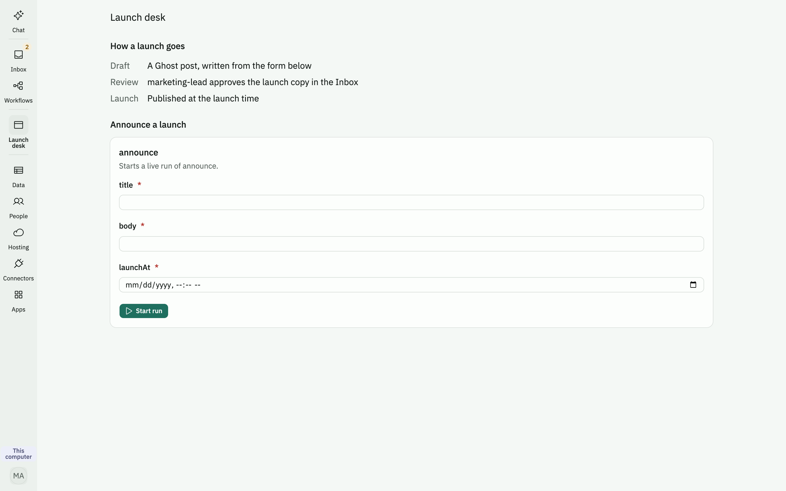

A site imports how its pages look from `sanoma/ui`, which is this package's `sanoma/ui`: the app's own components, so its pages look like the app's (Tailwind's classes and the theme's tokens apply to a site's files too: `bg-card`, `text-muted-foreground`, `bg-primary/10`; the app's theme has only its tokens, so Tailwind's default palette, `bg-white` or `text-red-500`, generates nothing there, only in [a site's own stylesheet](/sites/stylesheet/) without [the kit's](/sites/stylesheet/#the-kit-on-a-site)). It is presentational only: nothing in it talks to the running app (its queries, server functions, actor or config), so it could ship as a package of its own. It is an explicit list, and nothing else of the app is public:

- the shadcn components the app is built from: `Button`, `Input`, `Label`, `Textarea`, `Checkbox`, `NativeSelect`, `Slider`, `Badge`, `Separator`, `Skeleton`, `Spinner`, and the parts of `Field`, `Card`, `Alert`, `Table`, `Tabs`, `Dialog`, `Sheet`, `Popover`, `Tooltip`, `DropdownMenu`, `Empty`, `Item`, `ButtonGroup`, `Collapsible`, `Breadcrumb` and `Avatar`; `CodeBlock`, `CodeBlockContent` and `CodeBlockCopyButton`, a block of code with a button that copies it (a command to paste); and sonner's `toast`, shown by the app's toaster;
- the app's own pieces: `PageHeader` (a page's `<h1>`, its `title`), `Region`, `Facts` and `Fact`, `Tip`, `ButtonLink`, `ToneBadge` (with `dot`, a status pill), `toneBadge`, `effectBadge`, `StatusDot` (and the `Tone` type), `Notice`, `Nothing`, and `FloatingCard` (the one card with a shadow, for a selection shown over a page's card, placed by its `className`);
- the hook `useDensity` (Compact or not).

What talks to the app comes from `sanoma/site`, beside `api`:

- `RunForm({ workflow })`, the app's start form for a workflow, its fields drawn from the workflow's input schema;
- the hook `useActor()`, who is signed in (`actor`, `groups`, and `signOut` when the login has its own routes; the `ActorState` type).

`RunForm` names the workflow with a link to its page, starts a live run, with the server's complaints shown on the fields they name, and once the run starts stays on the page and links to the run, where its graph, ledger and approvals are. A name the config does not have renders a notice saying so.

```tsx
// sites/launches/routes/index.tsx
import { createFileRoute } from "@tanstack/react-router";
import { RunForm } from "sanoma/site";
import { Fact, Facts, PageHeader, Region } from "sanoma/ui";

export const Route = createFileRoute("/sites/launches/")({ component: LaunchDesk });

function LaunchDesk() {
  return (
    <>
      <PageHeader title="Launch desk" />
      <Region title="How a launch goes">
        <Facts>
          <Fact label="Draft">A Ghost post, written from the form below</Fact>
          <Fact label="Review">marketing-lead approves the launch copy in the Inbox</Fact>
          <Fact label="Launch">Published at the launch time</Fact>
        </Facts>
      </Region>
      <Region title="Announce a launch">
        <RunForm workflow="announce" />
      </Region>
    </>
  );
}
```



A site's page inside the app's shell: the kit's `Region` and `Facts`, and `RunForm`, from `sanoma/site`, drawing announce's fields from its schema.

With sites, the bar has a tile per site, between Workflows and the Setup group: its `icon` and its title, linking to its first page (its home, when it has one; a site whose every page has a path parameter has none, and no tile), lit on its pages. The build bundles only the Lucide icons the sites' `site.ts` name, so the server renders a site's icon in the page's first paint, and a name Lucide does not have shows the default for its kind. **Data**'s page header leads to **Sites** (`/sites`, the one path under `/sites` no site can take; Data is lit there), which lists each site in a table: its icon and title linking to its home, its app's name for an app's site, its folder, its pages, each named by its route's `staticData.crumb` or its path under the site (a page with a path parameter is left out), and where a public site answers, with its sitemap ([Public sites](/sites/public-sites/)). `sanoma/site` and `sanoma/ui` ship as source (`src/site.ts`, `src/ui.ts`), compiled by Vite in the company's build; they hold nothing server-side (a server function is a fetch in the browser).
