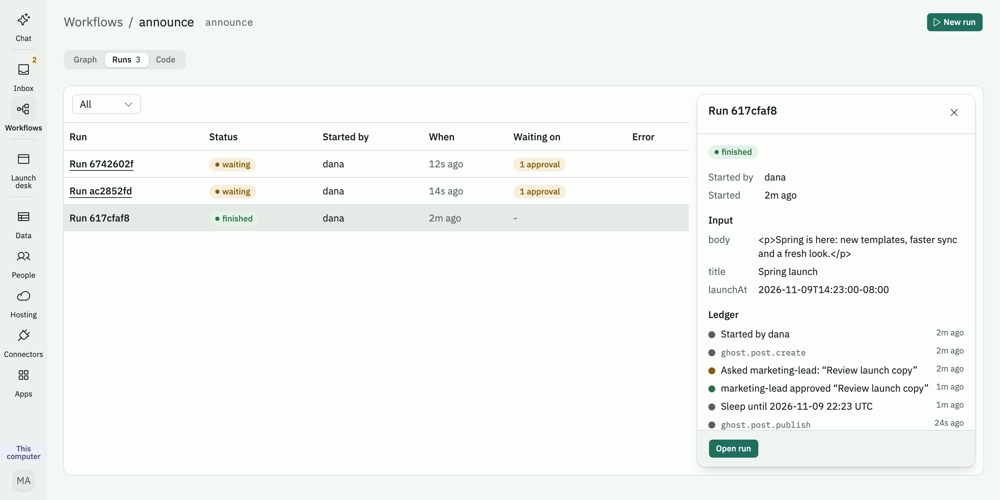
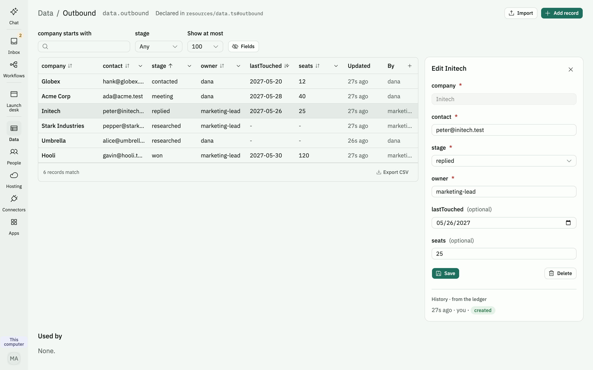

The bar's sections, in groups: Home, Inbox and Workflows; a tile per site ([Sites](/sites/overview/#sites)); then Setup, by purpose: Data (when the company has collections or sites), People, Hosting, Connectors, Apps and Permissions (when it has policies, `policies/*.cedar`). The app opens on Home. At the bar's foot a badge says the company's state, read from facts each time, never stored: **Local** (it runs on this computer), **Going live…** (going live's run has not ended), **Go live failed** (its last run failed, or failed the host's step) or **Live** (its host is bound, or this is the hosted instance), **Live · drafting copy** on this computer once the company is live; its tooltip names the database's host. The badge never asks the host anything, so a host that stops when idle is not woken by it. Under it, a company live on Sanoma Cloud sees its free trial: **Free trial · 5 days left**, **Free trial · last day** or **Free trial ended**, its tooltip the day and time it ends. It only informs. The app asks Sanoma Cloud at most once an hour and shows nothing while it cannot; any other company shows no trial and asks nothing. Old links still work: `/resources` to `/hosting` (with its `?resource=`), `/setup` and the pages under it to Hosting's, `/runs` to its All runs view, `/runs/<id>` to the run's page under its workflow, and `/start?workflow=<name>` to that workflow's page with New run open, which says if the workflow is unknown (`/start` naming none, to `/workflows`).

- **Workflow** (`/workflows/<name>`): one workflow's page, which takes the window's full width (as the Inbox, Workflows and a collection's grid do; the other pages keep to a reading width). Its header names the workflow under **Workflows**, with its name, and **New run** at its end (none for a retired workflow), which opens New run over the Graph. Under it, pill tabs, each its own URL (`?view=`), each keeping the rest of the URL's search:
- **Graph** (no `?view=`): the workflow's outline (see [Outline](#outline)), marked with the scenario `?scenario=` names, the inspector floating over its right (under it while the page is narrow, as with the chat column open on a laptop).
- **Runs** (`?view=runs`), with how many it lists: the workflow's latest 50 runs, newest first, in a table: each named by its id's first 8 characters (the whole id in its tooltip), with its status (and, while it waits, the first approval it waits on), a sandbox run's scenario, who started it and when. The **Show runs** menu shows all of them, or only live, sandbox, waiting or failed runs, kept in the URL as `?runs=`: live and sandbox are picked from the latest 50 (so the tab says it found none, or lists those it found, among the latest 50), while waiting and failed are the latest 50 with that status, however old. A row opens its run (`?run=<id>`) in a card floating over the list's right (above it while narrow), the row marked: its status, a sandbox run's badge and, while it waits, on whom and for what; its error; who started it and when; its input; its ledger as a short trace; and **Open run**, its page. The runs refresh every 2 seconds while one of them can still change, else every 30 seconds, and at once when you start a run or decide an approval.
- **Code** (`?view=code`): the workflow's source.
- **Scenarios** (`?view=scenarios`), with how many, when the feature files have any for it: each scenario with its file and how many steps it has; the one opened (`?scenario=<name>`) floats with its text, **Sandbox run** (New run in Sandbox mode with it chosen) and **Show on the graph**.

A workflow the config no longer has keeps its page while it has runs: its header names it, its Graph says it is gone and links to its Runs, and its runs draw a graph with only its name. With no runs either, its page is not found.

- **Run** (`/workflows/<name>/runs/<id>`): a run's page, under **Workflows** and its workflow's title, named **Run** and its id's first 8 characters, with its status, a sandbox run's badge, who started it and when, and **New run** (the workflow's). Under a notice for what it waits on (who, and for which approval, with **Show approval** to select it) or why it failed, the run's graph (see [Run graph](#run-graph)) with the inspector floating over it, then pill tabs, **Ledger** (open at first) and **Code**. A run of another workflow opens under its own. Its Ledger tab lists a sandbox run's **Checks**, drawn as the ledger's rows are: each `Then` of its scenario, which the worker runs (Cucumber) against the ledger when the run waits on an approval and when it ends, each on its own, met, failed with why, or "not yet" while its answer can still change (until the run ends, unless it expects a call that has been made); when the run's scenario is no longer in the feature files, or they cannot be read, Checks says why instead. Then the ledger as a timeline: the start, each operation call with its effect, the policy's decision, duration, input and output, each approval asked, decided or ignored, and how it ended; a sandbox run's says how many calls it was seeded with.

A workflow's Graph and Code, and a run's graph, Ledger and Code, are one view: clicking a node selects it, the graph rings it, Code marks its lines, and the inspector shows it, closing New run if it is open. Clicking a line in Code selects its node (the inspector then floats over the code, which leaves it room), and a ledger row's **Show in graph** button selects the node it is drawn as. The node selected stays as you switch between a workflow's Graph and Code; Runs and Scenarios drop it. The inspector shows, first match wins:

- **New run**, while the URL has `?new` (its close button drops it): two links, **Live vendors** and **Sandbox**, each its own URL (`?scenario=<name>` is Sandbox with that scenario, none is Live), then the form. `/workflows/<name>/new`, the old New run URL, redirects here, keeping `?scenario=` and `?runs=`.
- **Live vendors**: says which vendors the run calls for real and what the policy will do on a run you start (the will-ask line, as `RunForm` has it), then the form, built from the workflow's input schema: text, date and time (in your browser's time zone, shown as its ISO text until the page has loaded), numbers, yes/no, choices, lists with Add and Remove, and objects one level deep; anything else is entered as JSON. Optional fields left empty are left out, so the schema's defaults apply. The server checks the input with the workflow's schema and its complaints appear on the fields they name. **Start run** starts it and opens the run.
- **Sandbox**: a menu of the workflow's [scenarios](https://github.com/Sanoma-AI/sanoma/blob/main/packages/sanoma/workflows/README.md#scenarios-and-sandbox-runs) (**Sandbox** opens the first; with none, it is disabled and says so), and the form showing the chosen scenario's input with its controls disabled and no Add or Remove, since a sandbox run takes its input from its scenario. **Start sandbox run** starts it and opens the run, as you (a scenario's `Given ada is acting` is for `sanoma check` and tests, so the app never records a run as someone who did not start it): nothing leaves Sanoma, the fakes answering its calls. The scenario's lines of its feature file are behind **Scenario**, and the workflow's graph badges each operation a `Given` seeds ("seeded") or makes fail once ("fails", for `fails once`, `is rate limited once` and `loses its reply once`), and one a `Then` expects to be called ("expected"), not called ("not called"), denied by the policy ("must deny") or held by it ("must hold"), matching an outline's computed segment (`*`) as the run graph does. A scenario the feature files do not have says so. The scenarios are read again every 5 seconds while the page is open and when its window regains focus, so an edited feature file shows up without a restart; a file that cannot be read says why at the top of the workflow's page. The app decides nothing: the run's approvals wait for people, as a live run's do. Each sandbox run calls its own copies of the fakes, so several run at once, and one waiting on an approval holds up no other.
- **The selected node**: its kind, its step's name (when its call gives one) and label; for an operation, its id, effect and vendor and what it does; and **Lines a–b** of the source, which opens Code. On a run's page, also the node's ledger records (a held call's with the policy's request and decision, an approval's with its decision), and the approval it waits on with **Approve** and **Reject**, so it is decided in place.
- With nothing selected, **About** on the workflow's page: how it starts (by hand, or "Runs <cron> (<time zone>), next <time>", the next fire computed by the server), what it may call, its operations with their effects, its built-ins, its input and **Used by**: each site's page that calls it, under the site's title, through `RunForm` or `api`, linking to the page (a component's file, which is no one page, by its file); on a run's page, the run's facts (who started it, when and its id) and its approvals, each with the operations it lets through (badged by effect), and **Approve** and **Reject** with an optional note while the run can still read a decision. When the run has not read a decision within 5 seconds (no worker is running, say), it stays queued and the run reads it when it next runs: the dialog closes and the page shows the decision as queued, with Approve and Reject disabled for that approval, until the run's status changes. Every card but New run has a close button: closing hides the inspector (and drops the selection) until a node is clicked, and an **About this workflow** (on a run's page **Show the run**) button at the card's corner brings the overview back.

- **Inbox** (`/inbox`): the approvals, with how many are pending beside its title. Pill tabs pick the list, each its own URL (`?show=`): **For you**, the pending approvals you may decide (the default once the page knows who you are, and counted from then), **Everyone**, every pending approval (the default until then), both newest first and with how many they list, each with **Decided today** under it, the approvals decided since midnight (your browser's) in the latest 50 runs; and **Decided** (`?show=decided`), the approvals decided in the latest 50 runs, latest first. The list is one card: each row has the approval's title, how long ago it was asked (a decided one: its decision, and how long ago it was made), its workflow and who started the run, and opens it (`?approval=<runId>/<approvalId>`), marked while it is open. The open one, by default the first for you, else the first, floats over the list's right (above the list while the card is narrow, as with the chat column open on a laptop): its title and status, a sentence saying whose run of which workflow wants to do what (the operations it lets through, such as "publish a post in Ghost"), its details, and at its foot the same controls as on its run's page. Once you decide, it leaves the list and the next one opens; with nothing for you, a link shows those waiting on others. Refreshes every 5 seconds.
- **Changes** (`/changes`, in the bar after Inbox when the repository has a remote): the changes from a chat's draft card (**Save to** the company, or **Review**, offered once the draft has a commit and its checks pass), each draft's latest, newest first, **Open** and **Done** as pill tabs (`?show=`), each row its title, where it is, how many files it edits, its pull request and when it last moved. A change's page (`/changes/<id>`) shows where it is ("Waiting for admin", Published, Closed), its branch at the head it last planned, its pull request and its run; what changed, by kind (policies, people, resources, workflows, sites, each app's); who may do what, the Permissions grid of `main` against the branch's, each changed cell with its before and after; and, floating, Publish: the policy's answer, the checks, and once merged the merge commit and the deploy, with **Publish** and **Reject** while it waits. Publish is also the change's approval in the Inbox, with the change linked. How a change runs is the [runtime's](/workflows/changes/).
- **Home** (`/`): the company's name, then **Set up your company** with how many of its five steps are done, each from a fact (Start the company; Connect your agent; Try the sample workflow, a finished run of a workflow of the company's own; Add a teammate, a second person; Put it online, its host bound), each not done with what does it, and **Hide**, kept in a cookie (`sanoma_home_setup`); gone once all five are done. Under it, **Waiting on you** (the approvals you may decide, each opening in the Inbox) and **Recent runs** (the company's own latest ten, not the built-ins', with **All runs**).

- **Workflows** (`/workflows`): the window's full width. Its header says how many workflows the app has and the config's version (cut short, the whole of it in its tooltip), with **New workflow**, which opens the chat on a new chat with "Make a workflow that " in its composer for you to finish; a notice says so when the repo's policies do not hold, as they then refuse every call and start. Pill tabs, each its own URL with how many it holds, pick the rows (`?filter=`): **All**, **Waiting on you** (runs waiting on an approval you may decide), **Failed last run** and **Built-in**; the last tab is **All runs**. While the workflows are in more than one folder, a second row of tabs, **All**, **Yours** (the root's, the built-ins among them) and one per app (`?app=`), picks a folder, and the table puts each folder's under its heading, as Data does. Under them, one card: a box that finds a workflow by its title or name as you type, over a table of every workflow in the config, those whose runs wait on an approval you may decide first (badged with how many), then by their last run: its title (linking to its page), its name, built-in for the built-in `drift` (which starts like any other, with no input), how it starts (by hand, or the cron it runs on and its time zone), the vendors its operations call, in order of title, its last run's status and when, and how many approvals its runs wait on, on anyone. What it may call, its built-ins, its input and its outline are on its page. **All runs** (`?view=runs`) lists the latest 50 runs of every workflow, newest first: each with its workflow (linking to the run's page under its workflow, the run's id as its tooltip), a sandbox run's badge, its status, who started it and when, how many approvals it waits on, and a failed run's error. Its **Status** menu shows only the runs with that status, the latest 50 however old, kept in the URL as `?status=`; `?workflow=<name>` shows only that workflow's, named beside the menu with a button that removes it. The table refreshes as a workflow's Runs tab does. **New workflow** opens a dialog saying how to add one to the repo (a file under `workflows/`, listed in `sanoma.config.ts`, which the app shows once it restarts); drafting one from a description is coming.
- **People** (`/people`): who may act, as the data files declare them (`sanoma.person`, `.agent` and `.group`), with how many people beside the title, and the tabs **People**, **Groups** and **Agents** (`?show=`), each with how many. The problems with a declaration of theirs, or in a file that declares them, show above the table (their resources are left out, and nobody is admitted while there are any). People lists each person's name, email (`none` without one), groups (written on each group, read back by its members), how they sign in (an email code to their email, their GitHub login, or that they cannot) and when they last signed in and how (`Never` until they do), from the ledger; Agents lists each one's name, whom it acts for, its groups (also `agents`, muted and marked built in, the group the runtime puts every agent in) and the declaration, which opens in its file on Hosting; Groups lists each group's members, then, while there are agents, the built-in `agents` with them. A row opens over the list (`?person=<id>`, a group's name) with its file and export (opening it on Hosting) and its declaration's form (below): its fields from the type's schema, as declared, its id (a group's name) read-only, as the policy and the groups name it, and a group's members read-only, since they name declared people. On a host, each person's row, and their open card, has **Invite link** (only someone in `admin` makes one, and only for someone with an email declared; otherwise it is disabled and says why), which mints a one-use link that signs them in and shows it in a card, **Invite link for <name>**, with **Copy**, to send them however you like; a new link replaces their last.
- **Hosting** (`/hosting`): where the company runs, then the rest of what the data files declare at vendors. On top, a card per slot: Repository, Database, Host, Wakeup and Agent box (the sandbox the coding agents' boxes are opened in), each the declared resource whose type meets that contract (`resourceTypes[].capabilities`; the repository is the one the host clones), with its name, type, its plain declared fields, its binding and the latest drift verdict (with the fields that differ, and Adopt), the host's with where the last apply that made it says it answers and how it stays up, from its type (`resourceTypes[].host.lifetime`): Always on, or Stops when idle, what is due while it sleeps started by the Wakeup, or, with no Wakeup declared, a notice that none wakes it, so going live declares none and the host stays up. For a host that derives (`cloudflare.host`), its card also shows, read-only, what apply gives it (`hostDerived`, by `deriveHosts` as apply runs it, nothing minted): the runtime image, the repository and branch it runs, the public sites' domains it attaches, and each key it is given, stored or not and since when: `SANOMA_SIGNING_KEY` (or, when the config binds none, the host's own, `SANOMA_HOST_SIGNING_KEY`, generated into the store at its create), `SANOMA_SECRETS_KEY` with the built-in store, `SANOMA_SOURCE_KEY` and the wakeup's token; never a value. The agent box's card says whether each key its connector takes is set, with a link to the connector page where it is; a live instance that declares no sandbox says what to declare instead (on Sanoma Cloud, `cloud.sandbox({})`, with nothing to set; elsewhere `agent37.instance({})` and its key), since its coding agents refuse to run without one. While no host and no database are declared, and while going live has bound its repository but not yet its host (`resources/sanoma/infra.ts`), going live's steps show above them (**Go live**, below). Under them, **Other resources**: each other resource the data files declare (people are on People, collections on Data; its name, type and vendor, the declaration it comes from, which opens in its file below the table, marked, and the vendor object the lockfile binds it to, its id cut short), with the latest drift check's verdict: clean, drifted (with each field that differs, as declared and as the vendor holds it, shown under its row), gone, absent (not bound yet, and whether its identity found an object), error (and why), or not checked. Bindings in the lockfile that no data file declares are listed under the table, each with its key, type and id: apply asks whether to forget each or delete its object. **Apply** starts the built-in `apply` workflow on every declaration, and goes to its run; the config registers it beside drift. Apply holds its plan for a person: wherever an approval's details carry one, the Inbox and the run show it as the change view: problems in the data files, each change to the lockfile apply did not make in plain words ("points store at a different project: abcdefgh… → wxyzabcd…"), then the steps by action: creates with their planned fields (what the vendor fills in is "known after apply"), updates and replaces with the fields that differ (and, for a replace, the fields that cannot change in place), binds (found by identity, or given), gone objects and orphaned bindings with the question each asks, and the unchanged, folded. Each drifted field has **Adopt**, which writes the value the vendor holds, as that check's report has it, into the data file (`setFields`: only that declaration changes), commits it when the worker is given a `source` (the company's repository; without one it only writes the file), as an `adopt` run in the worker, and starts a drift check, which reads the file as it now is. A declaration's literal fields are written from a form too: **Edit**, beside the file a declared resource opens in (`?edit`), and a row of People open, draw the declaration's form (`components/declaration-form.tsx`): its type's schema's fields (less those only the vendor sets or never reads back), as the data file declares them, a field that names another declared resource and a person's, agent's or group's identity read-only. **Save** sends the fields you changed (a `patch` run, `{ at: { file, export }, fields }`, for a declaration the description names: a resource, a collection, a site or an app; it sets fields and removes none, so an emptied one is refused on the form) through the same writer, which parses the file and changes literals only: a field the file computes (a name or reference, a call, a spread) or a declaration that is no object literal is refused with the writer's reason (`invalid_input`, with the `field`), which the form shows under that field, read-only from then on, and stays the code's to change. Under the form, where it landed: **Saved as a change**, linking to its review, or saved to the file and the commit; a refusal (a 403) shows its reason. The form shows the declaration as the files hold it: the app makes its description again on the next request once a file it loaded changes (`liveDescription`), and a Save or an Adopt reads the config again, so what was saved shows on People, Hosting and Data at once. Where a Save lands: when the repository drafts and its remote has a connector's remote half, it is a change (**Changes**, above): the fields set in a draft of its own, `ui-<8 hex>`, committed there as you ("Change <fields> of <export>") and sent for review, the answer being the change's run, whose page is `/changes/<id>`; a change to the rules (a people file) waits for `admin` as any change to them does. Without a remote it is written and committed in the checkout as Adopt is, a people file (or a file one imports) only by someone in `admin` (403 for anyone else, since nothing would review it). Adopt and Save write the checkout one at a time. **Run drift** starts the built-in `drift` workflow, which reads the data files as they are then; the page reads the drift runs as a workflow's Runs tab does, every 2 seconds, links to the latest run, and shows the report of the latest that finished. Problems in the data files show under the tables, each at its file, line and column, since their resources are left out: those the app found when it started, and any the last check found. The declared list is the description's, made again once a data file, the lockfile or a folder they are in changes, so a declaration written since opens without a restart; the public sites' hosts and logins stay as the app started.
- **Data** (`/data`): the config's collections, with how many beside the title, in a table: each one's title and name, the field it is found by, its fields, the workflows that save it (**Written by**), the sites that call it (**Shown on**) and the file that declares it (opening its declaration on Hosting), a row opening its grid. While they are declared in more than one folder, the rows are grouped by it, the root's first (**Yours**), then each app's with its folder and source, and tabs above the card show All or one folder's (`?app=<name>`, `?app=.` for the root's), with how many each. How many records each holds is not shown yet. **A collection** (`/data/<name>`) is its records in a grid you edit in place, the page's full width: a column per field but a removed one (below), in the collection's order, then when each record was saved and by whom. Click or arrow to a cell (Shift and an arrow, or a drag, selects a range; Cmd/Ctrl+C copies it, tab-separated, for a spreadsheet), type or press Enter to change it, Enter to save it, Esc to cancel, Tab to save and move right: text and numbers in an input, a date in a date input, yes/no a checkbox, an enum's values and the declared people a menu. A free-form field's cell shows its value and changes in the record form, and its heading does not sort; a link's cell is the key of a record of the table it links to, opening that record there, struck through when that table has no such record. An edit shows at once and is one save of that record, made over the record as the edit found it (`ifRecord`); a record's edits, the form's too, are saved one after another, each over the one before, and a toast offers **Undo**, which puts that field back. A save the policy denies says why and the cell goes back to the record as it is; one it holds shows the record as it is stored, marked with a hollow dot, **waits for approval**, until its `call` run ends. A record someone changed since the grid read it is a conflict, never overwritten: the cell turns orange with what you typed, and a row under it says what is there now (who set what, and when, when the runtime says) with **Keep theirs** and **Use mine**. **Paste** a range (Cmd/Ctrl+V, tab-separated as Excel and Sheets copy one, quoted cells too) from the cell you are on, over the rows there and as new records past the last (each new record's key from the pasted column that lands on the key, else one to type before Save), or one value into every selected cell; drag the **fill handle**, at the selection's bottom-right corner, down to repeat its values; type into a selection to set every cell in it; **Delete** clears the selected cells, and deletes the records whose key is among them; **Shift+Enter** adds a record below the rows. Each value is read as its field reads it, so a number column gets numbers and an enum one of its values. None of these saves: they are staged as one change, its cells tinted with a bar at their left, new rows green, deleted ones struck, a cell its field cannot read (or a new record's missing key or field) in red, and a bar above the footer counts them ("6 changes in 3 records · from your paste: …") with **Review**, **Discard** and **Save as one change**; Cmd/Ctrl+Z takes back the last step, and while a change is staged an edit of a cell is a step of it, and the record form, the filters, the sort and the key links wait for it ("Save or discard the staged changes first"), as does leaving the page. **Review** lists each record's changed fields, as they were and as staged, the cells to fix first, and **Save n now**, which saves the records ready and leaves the rest staged. Save reads the records again first: one changed since it was staged is a conflict to settle, per cell, before anything is sent. Then the change is one call, `data.<name>.saveMany`, all or nothing, the policy deciding each record and the ledger recording each, in one run: a conflict it finds keeps the change to settle; a denial drops the records it refused, marked **refused**, and keeps the rest; a hold says the change **waits for approval**, linking to its run, and marks its records; any other failure saves nothing and keeps the change staged. The footer says how many records match, when you last saved, and the cell you are on; **Export CSV** downloads the grid as shown, a free-form value as its JSON text, which Import reads back. Drag a heading's edge to widen its column (kept per collection in this browser). A field's heading sorts by it, ascending, then descending, then by key again (`?order=`, `-` for descending); above the grid, **<key> starts with** keeps the records whose key starts with what you type (`?key=`), each enum field has a menu of its values (`?where=`), **Fields** hides some (`?hide=`, said by a chip that shows them again), and **Show at most** sets how many it reads, 100 at first, up to 1000 (`?limit=`); it says so when there may be more. **Columns**: each field's heading but the key's has a menu: **Rename**, **Change type**, **Hide for me** (`?hide=`, in your view only, as **Fields** does), on a free-form field each key its records hold with how many, to make a column of (**Convert to column**), and **Remove for everyone**, which takes the column out of the grid and the forms for everyone and keeps its values (the field stays declared, `hidden: true`); **+** after the last heading, or **New column** under **Fields**, opens the New column panel. **Fields** lists the columns hidden for everyone under **Hidden columns**, each with **Show again** (back in the grid and the forms, its values as they were) and **Remove for good…**, the one column change that deletes data: the declaration goes, every record's value in it is deleted, and the name is free for a new column. Its panel says how many records hold a value and asks you to confirm deleting them before it goes on; a count that changed before it was sent is refused and asked again. A new column, a rename or a conversion to a name records still hold values under (a column removed for good, or renamed, whose change's records weren't brought along yet) is refused until **Try again** on that change deletes or moves them, so a new column never takes over old values. Each opens a panel beside the grid (`?column=`) with what it takes (a name, a conversion's starting as its key; a type of the chips Text, Number, Yes / no, Date, A person, A choice with its choices one per line, Link to another table with **Links to**, a table of the collection's folder, and Free-form; Optional) and **What will happen** in plain words, drafted over the records on screen. A type change with values that won't convert (for a link, those that name no record of its table) shows them, a sample by key, and asks before it goes on: **Leave these n empty**, which removes what they hold, or **Keep them as they are**, so they show as **needs fixing** until someone edits them. **Review the change** proposes it (`proposeColumnChangeFn`): the collection's declaration in `resources/data.ts` edited by a `patch` run as a form's Save is, landed as a change for review that carries its plan and the choice, or, with no remote, written and committed, the records brought along at once and a toast saying what became of them (and, when Sanoma cannot start again on the new declaration by itself, that it shows once it does). The records follow the change when it lands (`sanoma.records.reshape`): a rename moves each value to the new name, a type change stores the values that convert as the new type and leaves the rest empty or as they are, as chosen, a free-form key made a column moves each record's value under it to the new column, converted the same way, hiding or showing a column leaves every record as it is, and removing one for good deletes its values. A table change's page reviews it in its words: a card per change (**Safe**, a rename among them; for a type change with values that won't convert, a sample of them and the choice made, **Clears n values** or **Keeps n for fixing**, read-only: sending the change back is how to choose the other way; **Keeps the data** for a column hidden, **Deletes n values** for one removed for good, saying they can't be brought back), **Try it first** (a copy, once previews land), **The details** (the declaration's lines), and **Approve and apply** and **Send back** for its Publish and Reject. Once applied, **The records** says what became of them ("297 contact values converted, 15 left empty"), or, when they could not be brought along, that the change is published and the records are as they were, linking its run, with **Try again**, which brings them along by the change's plan as you, a removal's values deleted and a link's matched against its table's keys as they are then (the policy decides it as you, and a hold waits for its approver in the Inbox, as the card says; the card follows the run and shows what became of the records once it finishes; it is refused once a later change made the columns something else), and **Copy the details** (what failed, the change and its runs, for whoever looks into it); **Couldn't apply this change · Nothing changed** is for a run that failed before merging. The plan is drafted by the app (`planOf` in `components/grid/plan.ts`) over every record when the change is proposed; and since repository writes answer 501 on the Cloudflare Worker, columns change from a laptop first. A record saved before its fields changed, which they now refuse, or whose link names a record that is gone, is badged **needs fixing**, what to fix in its tooltip; a save of it is refused until the link names a record or is cleared. **Add record**, or a record's key (or Space on its row), opens the record form beside the grid (`?new`, `?record=<key>`), drawn from the collection's fields (a removed one left out, and its value kept by an edit) as a start form is from a workflow's input: text, a number, yes/no, a choice for an enum, a date input for a date (one a workflow saved with a time shows as a date and time), and a person as their id, a new record's people starting as you; an edit's key cannot change. **Save** saves it (an edit over the record as the form read it, so one someone changed since is refused), and **Delete**, once confirmed, deletes it. The grid and the form change one copy of the records in the browser (a TanStack DB collection over the page's read of them), so each shows the other's change at once, without reading the records again. Every read and change is the collection's operation (`data.<name>.list`, `.save`, `.delete`) called through `api` as you, so the policy decides each and a save or a delete is in the ledger: a denial shows on the form; a call the policy holds for an approval says **Held for approval**, linking to its run of the built-in `call` workflow (`/workflows/call/runs/<runId>`), which makes it once approved in the Inbox; what the fields refuse shows under them. Under an open record's form, **History · from the ledger** lists its saves and deletes, newest first, each with when, who (a workflow's run by the workflow's name), the fields it changed (before → after; the first save says **created**) and a link to its run but for a direct call's, which has no page yet: read from the ledger by the record's target (`SanomaClient.history`), and only for someone the policy lets `get` the record, since the ledger holds its values (its latest 500 calls, reads among them: it says so when older changes are not shown); a saved toast's key opens it there. The header names the collection, its operations' prefix and where `resources/data.ts` declares it (opening it on Hosting), and **Used by** lists the workflows whose `uses` name one of its operations, then the sites' pages that read or write it, as a workflow's page lists those that call it. **Import** (`/data/<name>/import`, Data / the collection / Import) brings a sheet in, in three steps, each its own URL (`?step=match`, `?step=review`): **Upload** takes a CSV file, chosen or dropped (its first row names the columns; RFC 4180, so quoted cells with commas, quotes or line breaks read whole), and shows its first rows; **Match columns** has a select per column, matched to the field of its name (each field once, the key marked, a removed one not offered), **Skip**, and for a column no field is named for, a new field to add first (the collection's columns change through the file, not here, yet); a column whose values its field does not take as written lists each with how many rows hold it and what it stands for: an enum's value, a declared person (a name or an email guessed as that person; while nobody is declared, any id is taken as written), left out (filling nothing: a new record's field stays empty, an update keeps the record's), or **Fix first**; under them, the rows the fields would still refuse, by row and why. **Review** reads the records the sheet's keys have, as you, and counts the rows, the new records, the updates, the unchanged and those with problems, over a table of what each row will do: **add**, **update** (a changed field showing what it **was**), **unchanged**, or **fix first**, with why. **Add n, update m** starts a run of the built-in `import` (`sanoma/workflows`' [Importing a sheet](/workflows/collections/#importing-a-sheet)) as you and opens it: the policy decides each save, a denied row is left as a problem, a held batch waits in the Inbox, and the run's output lists what it added, updated and left. A workbook (`.xlsx`) is refused with how to save it as CSV: reading one in the browser would add a 930 kB library.

- **Permissions** (`/permissions`): what the policy answers someone in no group, in each group (the declared ones, `agents` and `visitors`) and `anonymous` (Anonymous, a public page with nobody signed in), across, for the start of each workflow, with each operation it uses under it, and each operation a person may call directly down, with the policy beside the page's title: Cedar, its files, its version and how many groups, workflows and operations the grid has, and a notice when the policies do not hold, as they then refuse every call. Each cell is the policy's answer for someone in that group alone (an agent acting for someone, so a hold for `on-behalf-of` asks "whom it acts for"; a visitor, denied a start and a direct call no `permit` names, and allowed an operation in a run), the input unknown: allow (muted), hold (with whom it asks), deny, or depends (the input decides); a hold, a deny or a depends opens the rule behind it in a sheet (its id, its file, its `@title` or `@reason`, and for a hold whom it asks), with Show the rule. While the policy's files are in more than one folder (the root's `policies/` and an app's), the tabs **All**, **Yours** and one per app (`?app=`) pick a folder: its files, and the grid's rows in it (its workflows, and its collections' operations; the vendors' at the root), and under the grid each folder's files sit under its heading. Under the grid, each policy file is shown read-only, titled by its path, as a workflow's Code tab shows its source (plain: the app has no Cedar grammar); Show the rule marks that rule's lines there. Nothing here is edited: the rules are `policies/*.cedar`, and the people and groups People lists. With a remote, a line under the grid says what the repository's host enforces on `main`: a pull request and the `sanoma` check, or what it lacks and why, in the host's words.
- **Apps** (`/apps`): the company's apps, with how many beside the title, in three lists, each app's name opening its page. **Yours**: the apps of its own (no source), each with its folder and what it holds (workflows, collections, sites). **Taken**: those merged from a source repository (`app.ts`'s `source`), each with its source, linked, and how many commits it is behind that source (fetched by the worker when it starts and after each push to `main`, or why it cannot tell). **Available**: the apps on GitHub not taken yet (the repositories with the topic `sanoma-app`, through the built-in `sanoma.apps.list`, called as you once the page knows who you are, so the policy decides it and GitHub never holds up the rest of the page), Sanoma's own first, each with its tier (Official, Vendor verified or Community, from Sanoma's claims, `sanoma/claims`), whether Sanoma reviewed it, its description and license, its README, a solution's demo (**Try it**) and **Add**. **New app**, **Add** and **Update** open the chat with a prompt for the agent ("Make an app that ", "Take the app from <url> into this company with take_app, …", "Update the app in apps/<name>/ from its source with update_app, …"), which drafts the change on a branch of its own; when GitHub cannot be searched, a notice says why and the repo's apps show all the same. **An app** (`/apps/<name>`) is its parts in one card: its header has, for a taken app, how far behind its source it is, **Source** and **Update**; then a line saying where it lives, and a section each for its **Sites** (its pages, what they call, who sees them), **Collections** (key and fields, opening the grid), **Workflows** (the operations each may call with their effects, its last run, its runs), **Policies** (each file under its `policies/`, how many rules and their reasons, to the Permissions grid) and **Scenarios** (each feature file under it, how many scenarios, of which workflows). People never sit in an app: they are declared at the root, on People.
- **Connectors**: each vendor the config's operations are from, by title, with its logo and id (never the built-in `sanoma` and `data`, which call nothing outside: a workflow's vendors and New run's "Calls … for real" leave them out too), how many operations it has and how many workflows use it, and, when its drivers declare environment variables, whether it is configured or how many variables it needs, each linking to its page, under Installed, with its tier (Official for an `@sanoma-ai/` package, else Community). Under Available, the connector packages on npm that the config does not install, found by the `sanoma-connector` keyword and shown by the `sanoma` field of each one's latest version (title, and logo files the server reads from jsDelivr and checks as an installed connector's are, shown as images only), with its tier, description and version; nothing is stored, and npm is read at most every 10 minutes. Choosing one opens the steps to add it (`?add=<package>`): `pnpm add`, the import in `sanoma.config.ts`, then its credentials; there is no install button. When npm cannot be reached, a notice says only the installed connectors show.
- **Connector** (`/connectors/<vendor>`): its [named connections](#connection-management), plus links to its connector's npm package and source (from `defineConnector`'s `package` and `homepage`, when it gives them), its resource types, and each operation with its effect, whether it is safe to retry, its description, its contract (input and output as JSON Schema), its scenario `phrases`, the scenarios with a step about it (each marked as seeding it, making it fail, expecting it or saying it must not be called, and linking to its workflow's New run in Sandbox mode with it chosen), and the workflows that may call it; a feature file that cannot be read says why above the operations, as on a workflow's page. A vendor with workflow operations whose connector attaches no fake (its `VendorEntry`'s `fake`) says "Its connector attaches no fake" once, above its operations; one with only a resource type's `read` and `import` needs none, since those read real state and a sandbox run never calls them.
- **Go live** (on `/hosting` while the company is Local, and `/hosting/connect`). On top of Hosting, a panel by the company's state, the host's health asked once as the page opens (not as a link to it is hovered, nor as the window regains focus; every few seconds while going live, and until a host just bound answers), with at most one ask every ten seconds: while Local, **Ready to go live** when `resources/sanoma/infra.ts` declares Sanoma Cloud (below), else the steps; **Going live** with its lines (repository, database, host, sign-in) and its run; **Go live failed** with the run's error, **Retry** and **Ask the agent** (on Sanoma Cloud, Retry is Ready to go live's Go live again; on your own accounts, **Back to the steps** too); **Live** with whether the host answers, on this computer that this is a drafting copy and, once the host answers, **Open, signed in as <your email>** (below), and on the hosted instance **Open on your Mac** (the desktop app, opening the company's repository). The steps' first, **Connect**, connects the company's GitHub and the vendors of its database, host and wakeup. When how far going live is cannot be read, its steps say why in their place, with Try again, and the rest of Hosting shows as ever. **Create GitHub App** (with an organization's login, or empty for your personal account) goes to `/setup/github/manifest`, a page that posts the App's manifest to GitHub (administration, contents, pull requests and commit statuses: write; push and pull request events, its webhook at the app's `/webhooks/github`, on unless the app is on this machine; its OAuth callback the staff sign-in's `/auth/better-auth/callback/github`, and email addresses: read, for the verified email), with its state and who asked in a signed, httpOnly cookie (nobody signed in is sent back here, told to say who they are first). You name and create the App on GitHub's page; GitHub sends you back to `/setup/github/callback`, which checks the state, exchanges the code (`POST /app-manifests/{code}/conversions`) and writes the App's id, slug, client id and secret, webhook secret and private key through the selected store as who asked (`SANOMA_GITHUB_APP_ID`, `SANOMA_GITHUB_APP_SLUG`, `SANOMA_GITHUB_CLIENT_ID`, `SANOMA_GITHUB_CLIENT_SECRET`, `SANOMA_GITHUB_WEBHOOK_SECRET`, `SANOMA_GITHUB_APP_PEM`), then comes back here saying how it went (sign-in uses the new client once the app restarts on a host beyond this machine). Step 1 ends with **Sign-in**, how people will sign in on the host (ready, or invite links only): you, signed in from this machine when the host starts (or, while the people file declares no email for you, to declare one), an email code through the config's `login.sender` once its connector is connected, GitHub through the company's App once its client is stored (and, when the App lacks the permission to read email addresses, which a sign-in with a private GitHub email needs, that Connect says what to add), and invite links always. While the email code is not ready, it has a `warning · not blocking` badge and the ways to fix it: name a sender in `sanoma.config.ts`, or connect the one named on Hosting › Connect, and, without GitHub, connect the GitHub App. A sender whose connector Connect does not list gets a row of its own there. When the config names a sender, going live gives the host its driver's variables among the host's `secrets` (`RESEND_API_KEY`; the address it sends from is the config's `login.from`). Once the host answers, **Open, signed in as <your email>** asks the host for an invite for the email the people file declares for you, sealed with the signing key it shares (the host's own, `SANOMA_HOST_SIGNING_KEY`, when the config binds none), and opens it. The page then shows the App's slug with **Install**, and, from GitHub's listing of the App, read as the App with its stored keys (at most every ten minutes, two seconds allowed), the permissions the manifest asks for that it lacks, as an App made before the manifest asked for them, or by hand, may: set them in the App's settings under Permissions & events, then accept the update on its installation. Vendors with named authentication use the same connection forms as their connector pages, instead of the old per-vendor token controls. Going live requires an explicitly declared default account that is connected; a sole connected account does not become a default automatically. Other bootstrap inputs, including the wakeup service's URL and account token, remain separate. Going live chooses by contract among the config's types whose vendor is connected (for the database and the host, a vendor this page does not connect counts as connected; the page names the vendors still to connect, and refuses a database or host other than the one it showed): the database (Neon's project first, else the first type that meets the `Database` contract, with its regions, which it holds the choice to, and size), the host (Cloudflare's container once its required connection is ready, else Docker's, else the first host; any host but Docker runs `ghcr.io/sanoma-ai/runtime:<the sanoma version the company installs>`, which Cloudflare copies into its account's registry at apply) and the wakeup (a connected one that wakes that host, the host's own vendor's first: Cloudflare's alarm before `sanoma.wakeup`). The repository is private, so going live also makes a new deploy key, its private half stored as the host's `SANOMA_SOURCE_KEY` (among its `secrets`, never shown) and its public half declared after the repository as a read-only `github.repository_deploy_key`, which the apply that makes the repository adds to it, and the host's apply waits for (a file written before deploy keys, or by **Connect an existing repository**, declares none, and its host clones as before); a GitHub connector with no such type is named among what is missing before anything is written. Every start of the host clones with it ([Cloning a private repository](/hosting/self-hosting/#cloning-a-private-repository)). When the config declares a host type, the page also offers **Connect a wakeup service**, for scale to zero: the [wakeup service](/hosting/wakeup/)'s URL, `SANOMA_WAKEUP_URL` (Sanoma's, or your own `sanoma wakeup`), and an account's token there, `SANOMA_WAKEUP_ACCOUNT_TOKEN`, both optional. Storing the account's token also mints the instance's own, `SANOMA_WAKEUP_TOKEN`, unless one is stored, and never shows it. With both stored and no wakeup of the host's own vendor connected, going live writes the runtime's own wakeup (`export const wakeup = sanoma.wakeup({ host })`, imported from `sanoma/resources`) into `resources/sanoma/infra.ts` after the host, mints `SANOMA_WAKEUP_TOKEN` when none is stored, and gives the host it (and `SANOMA_WAKEUP_URL`, for `sanoma.wakeup`) among its `secrets`, so the one apply of the host and the wakeup gives the worker on the host what it registers with; removing the line and answering its orphaned binding **delete** on Hosting deletes the instance.
- **Ready to go live** (on `/hosting`, on this computer, while `resources/sanoma/infra.ts` declares Sanoma Cloud and nothing of it is made, as a new company's template does). The company's **Address**, `<address>.sanoma.work`, which is also the name of the repository the Cloud makes: the one the file declares (the host's `hostname`), which you can change, also after a try that made the database (the company is bound by its id, so it moves to the new address as its host is made, and its repository keeps its name); once you are signed in to Sanoma, it is checked at the Cloud (available, yours already, or taken). **Go live** signs you in to Sanoma first when this app has no Cloud token: it opens www.sanoma.work's sign-in in your browser, where you sign in and allow it, and the browser comes back to `/hosting/sanoma/callback` on this app, which stores the token (`SANOMA_CLOUD_TOKEN`) and says you can go back to the app; the app goes live once it sees the token. A sign-in lasts ten minutes and works once. Then going live (the built-in `go-live-cloud`) writes a changed address into the file and commits it, has the Cloud make the company's repository in your GitHub account (through the Sanoma.work GitHub App), sets it as `origin` and pushes `main` with git's own sign-in, then makes the database and the host and waits for them. **Paste a Cloud token** stores one from your account at sanoma.work instead (Hosting › Connect, only a token that starts with `sca_`), and **Use your own accounts instead…** shows going live's steps (`?own`): going live there writes the file again. A Cloud token set in the company's `.env` is used as it is; the app cannot replace it. Once the host answers, **Open, signed in as <your email>** asks Sanoma Cloud for the sign-in link.
- **Connect an existing repository or database** (`/hosting/existing`, linked from the connect page): takes a GitHub repository (`owner/name`, its owner required) and/or a Supabase project's ref, reads each through its type's import (in the worker, as a `connect-existing` run, before any declaration names it; apply's own import, when it binds, is in the ledger), and writes `resources/sanoma/infra.ts` from what was read: the repository's owner, name, description and visibility; the project's name, organization and region, with its database password declared as a generated secret, which Supabase never reads back, so the next apply that changes the project sets a new one. In a repository without a remote, the file is committed where the checkout is; with one, on a new branch, `setup/connect-existing`, checked out, and the page shows the diff: merging it is the approval. Then the run starts apply as its child with `bind` and `only` for those declarations, which binds them in the lockfile (committed on the same branch) and creates nothing. Refused when `infra.ts` or the branch is there already.

Named authentication uses the connection forms below. A connector that still declares only an `env` schema retains its separate credential fields; those are not account selectors. Named connections never gain an environment-first fallback or process-wide credential swapping.

The screens share one shell: down the left, the bar, and beside it the chat column, then the page. The bar has **Chat** first, then the sections and the sites' tiles in their groups, each an icon in a tile with its label under it, the current one filled (Inbox badged with how many approvals are pending), and at its foot the menu under your initials. **Chat** folds the chat column away and opens it again, and the app opens it as you left it on your next visit (it keeps that in a cookie, `sanoma_chat`, so the server renders the page with it open or folded from the first paint); until then it is open where it sits beside the page and folded where it would lie over it. The column is your chat with the agent: your latest chat (the others, and **New chat**, at its top), your messages at the right, its replies under them with the steps it took as a checked list, and at its foot the composer, carrying the page you are on. Until the agent is connected (our loop without its model's key, and no engine chosen), a new chat shows **Connect your agent**: **Your Claude plan** (recommended; **Sign in with Claude** starts Claude Code's sign-in at once), **Your ChatGPT plan** through Codex (on a live instance **An OpenAI API key**, not offered yet, since OpenAI's plan sign-in is this computer's), **An API key** (the Anthropic connector's page) and **More agents** (Copilot, OpenCode, Pi); **Agent…** in the menu at the bar's foot shows them again. The engine chosen there or in the composer is the one your new chats open on, kept in a cookie (`sanoma_engine`). Once it is connected, the agent speaks first in your first chat (titled Getting started): who it is, what it read in the company (its workflows, connectors and people) and a few suggested asks, each a button that sends it in the chat; after a sign-in it asked for, it speaks once that is done. A reply that ends with suggested asks (after a change, two next ones) shows them the same way, never as text. The agent edits only a draft of its own, a branch `draft/<chat>` it opens at its first edit and commits to as it goes, and runs the checks there; its reply ends with the draft's card (the branch, what changes, the checks), with **Save to** the company once something is committed and the checks pass. Without a remote a connector reviews changes on, Save puts it to work at once: the draft is merged into the company as one commit titled as the chat, `main` is pushed to the repository's `origin` when it has one (the card says so when the push fails; the save stands), and the worker and the app start again on the files (a page open meanwhile catches up by itself); the card then says who saved it and when, with **Open the workflow** and **Undo**, which saves a draft reverting it the same way. With such a remote, Save opens the draft's change, published at once when the policy lets you decide it, and **Review** opens it for someone else's review ([Changes](/workflows/changes/)). It takes an app into the draft with `take_app`, a git merge of the source repository (an `https` URL) whose `apps/<name>/` lands as the company's, every other file staying the company's but `package.json`, which gets the source's beside its own, and updates one with `update_app`, a merge of the new commits of the source its `app.ts` names, as far as they touch `apps/<name>/` and `package.json`; a file git cannot merge is committed with its conflict markers, which the agent resolves before the checks pass ([Apps](/start/apps/#apps)). `takeAppPrompt` and `updateAppPrompt` (`src/lib/apps.ts`) are what the Apps page's Add and Update put in the chat. The agent has `/mcp`'s six tools too ([Agents over MCP](/start/agents-over-mcp/)): it reads the company's description, looks something up, starts one of the company's own workflows, reads a run, waits for one and checks for drift. It makes each call as the runtime's agent `sanoma-chat` acting for you: the policy sees `sanoma-chat`, in `agents`, with `onBehalfOf` you, and is asked again as you alone, the stricter answer standing, so the chat may do no more than you may; it starts none of the runtime's own workflows (drift has its own tool, which the policy decides as an agent's); a company's policy holds or forbids it by `principal in Sanoma::Group::"agents"` or `principal == Sanoma::Principal::"sanoma-chat"`; the ledger, the run's trace and the Inbox say `sanoma-chat for ada`, and you may approve a hold on a run it started for you. Only the app's worker makes this principal, for the person whose chat turn it is: `x-sanoma-agent` refuses `sanoma-chat`, no sign-in admits it, and acting for no one it is nobody. What it starts runs the company's merged workflows on the live instance, never the chat's draft, which runs nowhere until it is saved. A call or start the policy holds shows its approval's card in the reply (or who it waits for, with the Inbox's link), and the tool waits for the decision (ten minutes at most on Sanoma, fifteen seconds on Pi or Claude Code), then answers with the run, or that it still waits, with its id and whose decision it waits for; a stop ends any wait. Once such a run is decided, the reply shows what became of it in place of the card, and the agent is told so in its next turn. A run that started and then failed is answered with its id, that it failed and why (the step reads **Started … : the run failed**), not as a start that was refused, so the agent does not start it a second time. Each call's id is the chat's, its turn's and the tool call's, and each reply records its turn, so a restart that cut a start short answers from the run it left rather than having the agent start it again. What this changes for an existing chat: a lookup is asked of the policy as `sanoma-chat` as well as you, its driver sees `sanoma-chat` as the principal, and a held one is named for it (`call:sanoma-chat:…`); a workflow the chat starts whose calls select a connection that belongs to a person (a connection rule's) is refused, since the run's actor is `sanoma-chat`, not its owner. The chat is kept in the company's database: a restart loses the turn under way, not the chat or the draft, and **Continue** picks up. The model is the first connector with a model half, its default; without its key, the reply says so with a link to its connector page. A new chat's composer picks its engine, each with its mark (a coding agent's from its connector), which the chat keeps, the agent with the account it runs on, and names at its top: **Sanoma** (our own loop, the default), or an existing coding agent on the company's Anthropic key, **Pi** or **Claude Code**, driven through the AI SDK's `HarnessAgent` in the person's box, one per person per company, kept across restarts: in the sandbox the company declares (one `agent37.instance` in a data file, which going live writes into `resources/sanoma/infra.ts` once Agent37's key is stored; on Sanoma Cloud, `cloud.sandbox({})`, whose boxes Sanoma Cloud opens with the company's Cloud token), each box an Agent37 instance its connector opens, else, on this computer, a directory of its own (`.sanoma/agent-home/boxes/<box>`); a live instance that declares none refuses the coding agents, the reply saying what to declare, so no agent ever runs inside the live instance. Each turn opens the box, brings the chat's draft into the box's clone (`repo/`) as a git bundle, which carries commits and the branch alone (no remote, no token, no secret of the company's), and runs `pnpm install --frozen-lockfile --ignore-scripts` there with the box's own pnpm (never the one a `packageManager` field names) on the first turn and whenever the lockfile changed, so the box keeps a second `node_modules` of its own. Pi and Claude Code get `/mcp`'s six tools as host tools (`HarnessAgent`'s `tools`), run in the worker as for Sanoma: Pi runs in the worker, and Claude Code's bridge offers them to it as an MCP server inside its own process that sends each call back over the bridge's socket, so no URL, token or secret of the instance reaches the box. A coding agent reads the repository's `AGENTS.md` itself; its file edits are allowed inside the clone and refused outside it (by their real paths in the box, where the files are) or under `.git` or `node_modules`, its shell commands are refused, each with the reason shown as a refused step (so taking or updating an app is the Sanoma engine's) (Claude Code reads files itself, as this machine's user: only its edits and commands ask); at the end of its turn its edits are committed in the clone as the person, brought back to the draft as a bundle, and the draft checked in the box (`sanoma check` in the clone, with no database URL or credential of the company's, so on a Postgres of its own). One turn runs in a box at a time: a second, from another of the person's chats, is refused until the first ends, and a draft's check (Review's, or the Sanoma engine's) waits for it; a box that fails mid-turn loses that turn's edits, and says so. Claude Code's first turn in a box installs it under the box's home (about 760 MB, 40 s), which needs pnpm 11 and bash on the `PATH`; its bridge listens on all interfaces, guarded by a token, so keep that port behind a firewall. Under **Your own plan**, the composer offers a person's own coding agent, on their own subscription, driven over the Agent Client Protocol by the app's own client in the person's box, on its clone of the chat's draft: **Copilot**, **OpenCode** (its free models need no sign-in), **Pi**, **Claude Code** and **Codex**, as far as their connectors are installed. A live instance offers no coding agent while it declares no box, and not **OpenCode** or **Pi** on a person's plan, whose sign-in is a command run once on the person's own computer. A person's own agent spends that person's plan under their vendor's terms, which Sanoma neither checks nor changes. It gets none of `/mcp`'s tools: the Agent Client Protocol gives an agent only MCP servers it reaches itself, a process or a URL with its credential in the box, and the box holds no remote URL, git token or company secret of the instance's, only the turn's model key. ACP's MCP transport over the agent's own connection, not yet stable, is how it would get them. The agent runs in the person's box (on a laptop, a directory of this machine) with an environment of its own: its `HOME` is `.acp` in that box (`.sanoma/agent-home/boxes/<box>/.acp`, kept across restarts), so a sign-in is kept for that person and never the company's (every person's agent runs as this machine's user, so on an instance several people share, what an agent runs itself can reach another person's sign-in), and none of the app's or this machine's credentials reach it (no token variables; `gh`, `security` and the browser openers refuse on its `PATH`). Its first turn on a machine installs it there (`.acp/<agent>`) with the pnpm on the `PATH` (the desktop shell ships its own), in 10 to 45 s and 150 to 340 MB each. So `.sanoma/agent-home/boxes` holds a box for each person of the company: its home is Pi's and Claude Code's on the company's key (whose session's files are the clone's and that home's only, never its `.acp`; Claude Code's own reads and the commands a bridge runs are this machine's user's), and its `.acp` the person's own agents' (their `HOME`, installs and sign-ins, given only to that person's agents). The `harness`, `acp` and `people` directories of earlier versions are no longer read: delete them by hand. When the vendor asks the person to sign in, the reply is a sign-in card: the vendor's link and code (Copilot's and Codex's device flows), with a field for a code the vendor asks to have pasted back (Claude Code's), or, for Pi, whose sign-in needs a real terminal, the command to run once on this computer; the app opens no link and enters no code, the card keeps neither once it ends, and after signing in the person sends the message again. The agent's requests to read or edit a file are allowed inside the clone and refused outside it or under `.git` or `node_modules`, as are its requests to run a command and anything else it asks for, each with the reason as a refused step (it is never given an always-allow); the files it reads and writes through the app are the clone's only. What it runs in the app's terminal, and what its own tools do without asking (OpenCode edits and runs commands inside the clone without asking), are its own: the commit brought back to the draft and its checks, at the end of the turn, are the gate. From 1024 px wide the column sits beside the page; narrower, it lies over the page; on a phone (under 768 px) there is none, and the bar is a sheet over the page, opened from the menu button atop it, that closes as you follow a link or tap beside it. Each page starts with its title, with what it counts beside it and the pages above it as links (Workflows, then the workflow's title, on a run's page), its actions at the end of the row; then, on a page with views, pill tabs, each a URL; then one card. What you open from a list, an approval, a run, a scenario or a graph's node, floats over the card's right in a card of its own, and sits above the list (under a graph) while the page's card is too narrow. **Density**, in the menu at the bar's foot under the theme, switches the page to **Compact**, a tighter density for people who live in the app: the page a quarter tighter in every padding, gap and control (its icons too; the text keeps its size), half the gap between a page's regions, a lower graph card and source (a floating card keeps its width). The browser remembers the density in a cookie (`sanoma_density`), so the server renders the page in it from the first paint. The menu at the bar's foot, under your initials, has who you are (and Change name, under the default resolver), the theme (light, dark or the system's, which the browser remembers) and the density. Inside the [desktop app](https://github.com/Sanoma-AI/sanoma/blob/main/packages/desktop/README.md)'s window it also lists the companies open there, this one checked: choosing another switches the window to it, and **Add company…** shows the desktop app's start screen (`src/lib/desktop.ts`, over the `window.sanomaDesktop` the desktop app gives the page; in a browser there is none, and the menu has no Companies). The screens are built with [shadcn/ui](https://ui.shadcn.com) components (`src/components/ui`, from `components.json`) on Tailwind CSS, in the theme `src/style.css` holds: Sanoma's palette in light and dark, IBM Plex Sans and Mono (Fraunces for display), and 28 px controls.

## Connection management

`/connectors/<vendor>` renders named connection requirements from code and the admitted person's account metadata. Each card shows its name, authentication method, verified account and grants, required scopes, owner, binding status, last change, and the selected store/namespace/path with management ownership. A changed binding shows its previous destination so the person can review the move. Loading cards reads metadata only; **Test** deliberately checks the provider. Health is labeled with its last-check time, not presented as continuous monitoring.

A card links the workflows found in code to select that account literally or through its declared default. Calls whose selector is only known at runtime are marked as possible dependencies. This is a static reading of workflow code, not a complete execution history or a promise that every listed workflow will use the account.

**Connect** and **Replace credentials** generate password controls from the authentication input schema, with JSON entry for structured fields. Fields start empty; schema defaults and examples never populate them. **Verify and review** checks policy, verifies the account and grants, then shows the destination and any change from the previous account or location. **Save connection** revalidates the review, reserves the account as pending, writes through the selected store and verifies activation under policy. During this process the previous binding can become unavailable; the card reports pending or uncertain outcomes rather than claiming success. A location change retains the previous stored value and is not a transfer.

Credential values live only in the open form and secure server requests. They do not enter query or mutation caches, browser storage, URLs, chat, workflow history, approval records or ledger records. Closing the dialog or completing Save clears the form. When policy holds an action, its notice links to the approval run; decide it there and retry the same action in the still-open form. Closing that form requires entering the credentials again.

Externally managed bindings and read-only stores offer **Review connection**, not replacement fields. Replace or renew values at the displayed management location, then **Test**. For a pasted credential, **Disconnect** invalidates the Sanoma binding; it does not delete its stored value or revoke access at the vendor. An OAuth grant's Disconnect and Revoke are described below. Dynamic **Connect account** choices appear only for code-defined rules the person may use; the runtime also enforces policy and ownership. A method without account verification cannot be connected here. Externally renewed OAuth bundles can be reviewed where their verifier and store support it.

The page lists every way to connect the vendor, so a connector with both an OAuth method and a pasted token (Supabase) shows both. An OAuth method's **Connect account** (or **Reconnect**) asks for the company's OAuth application, its client ID and secret, the first time; later attempts can leave both empty to reuse the stored one. **Continue to <vendor>** opens the provider in a new tab. The page that started it shows the attempt: waiting for consent, storing the grant, waiting for an approval (with a link to the run), connected, or failed with a plain reason. The provider sends the person back to `/connect/<vendor>/callback`, which checks that this browser started the attempt (a signed cookie per attempt, `sanoma_connect_<key>` named by its state's hash, sent only to `/connect`) and its state. It seals the code into the attempt and starts the `connect` run. Then it redirects to `/connectors/<vendor>` with the attempt's ID. Its URL never carries the code or state onward, and it logs no query string. A refused callback comes back as `?error=` with one of `expired`, `mismatch`, `replayed`, `declined`, `rejected` or `failed`, shown as a sentence, never the provider's words. The card then shows the account, its scopes and when access is valid until. A store that cannot keep a grant (read-only or without conditional writes) disables Connect and says why.

The runtime [renews a grant](/workflows/credentials/#renewal-reconnect-disconnect-and-revoke) on its own, and the card shows it: **Valid until**, **Renewed** with the time of the last renewal (and the next one scheduled, for a provider whose refresh tokens lapse unused), and the last renewal's failure when it failed. A renewal that may have spent the refresh token without storing the new grant marks the account **uncertain**, and one the provider refused (revoked or rejected) marks it **needs reconnect**; both explain that **Reconnect** asks for new consent, which replaces the grant whole. **Test** verifies the grant, renewing it first when it is due. **Disconnect** deletes the grant Sanoma keeps and keeps the OAuth application, so the next account can reuse it. **Revoke**, shown when the connector can revoke at the provider (Supabase can), asks the provider to revoke the grant and then disconnects; it is its own policy decision (`sanoma.connection.revoke`), and nothing changes when the provider does not confirm.

**Secret storage**, shown on the connector list and setup page, reports the effective provider, namespace, bindings, ownership and bootstrap readiness. These settings come from code, so selecting another store is a code change; **Move**, below, carries the values to it. For the built-in store, the panel explains its separately supplied encryption key; it does not expose the key. [Supabase Vault](https://github.com/Sanoma-AI/sanoma/blob/main/connectors/supabase/README.md#supabase-vault-as-the-secret-store) is available as a configured provider adapter.

When the config names other stores (`secrets.stores`), the panel moves the secrets to one of them ([Moving between stores](/workflows/credentials/#moving-between-stores)): choose the destination and the rollback window, review the plan (each secret's kind, what happens to it and its size; never a value; the destination's problems refuse the start), then start the `migrate-store` run. The panel follows it: writes to the current store paused, the copies read back, then the code change to make, `secrets` selecting the destination, which the move waits for and cuts over on. After the switch it shows the rollback window and, once it ends, the retired old copies. Cancel stops a move before its cutover. Connections whose OAuth application differs at the destination are flagged to reconnect.

The operator agent's `connection_status` tool reads account requirements and last-tested metadata with a link to `/connectors/<vendor>`. It does not fetch credentials or test a provider. The agent directs people to secure input and never asks them to paste a key, password or OAuth token into chat.

## Run graph

A run's page draws the run as a graph, left to right: the start, each operation call (its effect, the policy's decision, its duration or error), each sleep, each approval the workflow asked for, and how the run ended, or a dashed end while it has not. An approval the policy asked for sits on the call it holds. The calls of one `ctx.all` branch out side by side and join again after it. Each node's colour says how it went: done, failed or denied, waiting on a person or a sleep, or running. The graph is read from the ledger alone, so it shows what happened, not what the workflow may still do, and it redraws as the page polls. Clicking a node shows it in the inspector, scrolls to its record while the Ledger tab is open, and marks the call in the workflow's source under **Code**: the one the worker placed the call at, which the record names (`node`), when the source still has that call there, so a loop's every pass marks its one call, and a call from a ledger written before calls were placed, or whose file has changed so that another call or none is where it was, marks nothing rather than a guess. Clicking a call in the source selects its node: of a loop's passes, the latest. A sleep is labelled with the time it ends, in UTC, as the ledger shows times, so the server and every browser draw the same text. It is drawn with [React Flow](https://reactflow.dev) in the browser only; the server renders a placeholder of the same size, the graph's code loads, once, only on the pages that draw a graph (a workflow's and a run's), starting as the page's data loads, and each graph is drawn when it first scrolls near the screen. A graph pans sideways with the scroll wheel or a drag; its zoom control (React Flow's zoom slider, in the bottom left corner) zooms out and in, shows the zoom (a click sets it back to 100%), and fits the whole graph in view.

A `ctx.all` draws as one lane per member, top to bottom in member order, between the step before it and the step after: in a run that posts to three vendors at once, sleeps, then reads two results at once, the graph shows three lanes, the sleep, then two lanes, each lane coloured as its call went (a call the policy holds waits in its own lane). While a `ctx.all` is the last thing the run has done and the run goes on, each member that has recorded nothing yet has a dashed "not started" lane. Members that never ran, after one failed, or once the run has moved past the group or ended, have no lane. An operation whose call has a [step name](/workflows/built-ins/#step-names) other than its id says the name, with the id on the line below; a sleep with a name says it the same way, above its clock and the time it ends. A long loop label is cut short in its box; hovering shows it whole.

## Outline

Each workflow card on the Workflows page, and a workflow's page, draw the workflow's shape before it runs, from the `outline` that `describeConfig` (`sanoma/workflows/describe`) reads once per workflow when `startApp` starts; the source under a workflow page's Code tab is the workflow's file as it is when the page asks for it. It is the run graph's drawing without colours: the operations (with their effects), approvals and sleeps the body of `run` calls, a `ctx.all` as lanes, a loop or a `ctx.all` over a list as a box labelled from its code ("for each of subscribers", "repeat while more") (the line into the box goes on inside it to its first nodes, and its last nodes join the line out), an operation or sleep by the name its call gives, and an `if` or `switch` as a diamond that splits into one lane per case, plus a lane marked "otherwise" when the run can go by without any of them (an `if` without `else`, say). It is a reading of the source, labelled so: "Read from the body of run; the functions it calls are not shown, even those defined in it". When the source cannot be read the card says why instead.
