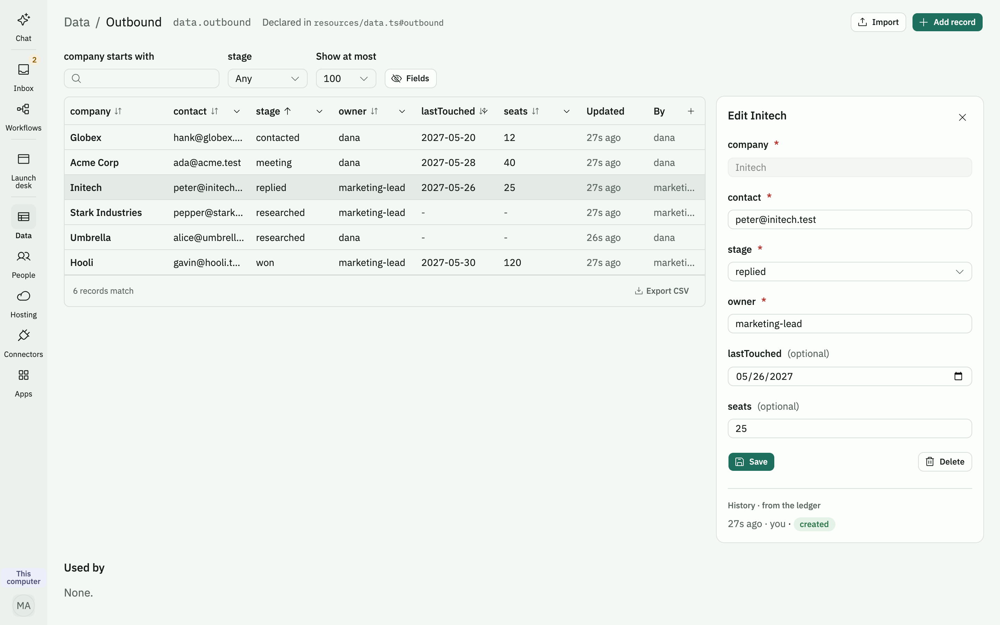

Open **Data**, choose the collection, and select a row. To bring in several records from a file, [import a CSV](/using-the-app/import-records/).

## Data

Open `/data` to find a collection. The title shows the number of collections. The table lists each one's title and name, the field it is found by, its fields, the workflows that save it (**Written by**), the sites that call it (**Shown on**) and the file that declares it (opening its declaration on Hosting), a row opening its grid.

While they are declared in more than one folder, the rows are grouped by it, the root's first (**Yours**), then each app's with its folder and source, and tabs above the card show All or one folder's (`?app=<name>`, `?app=.` for the root's), with how many each. How many records each holds is not shown yet.

### Edit a collection

**A collection** (`/data/<name>`) is its records in a grid you edit in place, the page's full width: a column per field but a removed one (below), in the collection's order, then when each record was saved and by whom. Click or arrow to a cell (Shift and an arrow, or a drag, selects a range; Cmd/Ctrl+C copies it, tab-separated, for a spreadsheet), type or press Enter to change it, Enter to save it, Esc to cancel, Tab to save and move right: text and numbers in an input, a date in a date input, yes/no a checkbox, an enum's values and the declared people a menu.

A free-form field's cell shows its value and changes in the record form, and its heading does not sort; a link's cell is the key of a record of the table it links to, opening that record there, struck through when that table has no such record. An edit shows at once and is one save of that record, made over the record as the edit found it (`ifRecord`); a record's edits, the form's too, are saved one after another, each over the one before, and a toast offers **Undo**, which puts that field back.

A save the policy denies says why and the cell goes back to the record as it is; one it holds shows the record as it is stored, marked with a hollow dot, **waits for approval**, until its `call` run ends. A record someone changed since the grid read it is a conflict, never overwritten: the cell turns orange with what you typed, and a row under it says what is there now (who set what, and when, when the runtime says) with **Keep theirs** and **Use mine**.

### Paste and review a range

**Paste** a range (Cmd/Ctrl+V, tab-separated as Excel and Sheets copy one, quoted cells too) from the cell you are on, over the rows there and as new records past the last (each new record's key from the pasted column that lands on the key, else one to type before Save), or one value into every selected cell; drag the **fill handle**, at the selection's bottom-right corner, down to repeat its values; type into a selection to set every cell in it; **Delete** clears the selected cells, and deletes the records whose key is among them; **Shift+Enter** adds a record below the rows.

Each value is read as its field reads it, so a number column gets numbers and an enum one of its values. None of these saves: they are staged as one change, its cells tinted with a bar at their left, new rows green, deleted ones struck, a cell its field cannot read (or a new record's missing key or field) in red, and a bar above the footer counts them ("6 changes in 3 records · from your paste: …") with **Review**, **Discard** and **Save as one change**; Cmd/Ctrl+Z takes back the last step, and while a change is staged an edit of a cell is a step of it, and the record form, the filters, the sort and the key links wait for it ("Save or discard the staged changes first"), as does leaving the page.

**Review** lists each record's changed fields, as they were and as staged, the cells to fix first, and **Save n now**, which saves the records ready and leaves the rest staged. Save reads the records again first: one changed since it was staged is a conflict to settle, per cell, before anything is sent.

Then the change is one call, `data.<name>.saveMany`, all or nothing, the policy deciding each record and the ledger recording each, in one run: a conflict it finds keeps the change to settle; a denial drops the records it refused, marked **refused**, and keeps the rest; a hold says the change **waits for approval**, linking to its run, and marks its records; any other failure saves nothing and keeps the change staged.

The footer says how many records match, when you last saved, and the cell you are on; **Export CSV** downloads the grid as shown, a free-form value as its JSON text, which Import reads back.

### Column width and sort order

Drag a heading's edge to widen its column (kept per collection in this browser). A field's heading sorts by it, ascending, then descending, then by key again (`?order=`, `-` for descending); above the grid, **`<key>` starts with** keeps the records whose key starts with what you type (`?key=`), each enum field has a menu of its values (`?where=`), **Fields** hides some (`?hide=`, said by a chip that shows them again), and **Show at most** sets how many it reads, 100 at first, up to 1000 (`?limit=`); it says so when there may be more.

### Change a column

**Columns**: each field's heading but the key's has a menu: **Rename**, **Change type**, **Hide for me** (`?hide=`, in your view only, as **Fields** does), on a free-form field each key its records hold with how many, to make a column of (**Convert to column**), and **Remove for everyone**, which takes the column out of the grid and the forms for everyone and keeps its values (the field stays declared, `hidden: true`); **+** after the last heading, or **New column** under **Fields**, opens the New column panel.

**Fields** lists the columns hidden for everyone under **Hidden columns**, each with **Show again** (back in the grid and the forms, its values as they were) and **Remove for good…**, the one column change that deletes data: the declaration goes, every record's value in it is deleted, and the name is free for a new column. Its panel says how many records hold a value and asks you to confirm deleting them before it goes on; a count that changed before it was sent is refused and asked again.

A new column, a rename or a conversion to a name records still hold values under (a column removed for good, or renamed, whose change's records weren't brought along yet) is refused until **Try again** on that change deletes or moves them, so a new column never takes over old values.

Each opens a panel beside the grid (`?column=`) with what it takes (a name, a conversion's starting as its key; a type of the chips Text, Number, Yes / no, Date, A person, A choice with its choices one per line, Link to another table with **Links to**, a table of the collection's folder, and Free-form; Optional) and **What will happen** in plain words, drafted over the records on screen.

A type change with values that won't convert (for a link, those that name no record of its table) shows them, a sample by key, and asks before it goes on: **Leave these n empty**, which removes what they hold, or **Keep them as they are**, so they show as **needs fixing** until someone edits them.

### Review a schema change

**Review the change** proposes it (`proposeColumnChangeFn`): the collection's declaration in `resources/data.ts` edited by a `patch` run as a form's Save is, landed as a change for review that carries its plan and the choice, or, with no remote, written and committed, the records brought along at once and a toast saying what became of them (and, when Sanoma cannot start again on the new declaration by itself, that it shows once it does).

The records follow the change when it lands (`sanoma.records.reshape`): a rename moves each value to the new name, a type change stores the values that convert as the new type and leaves the rest empty or as they are, as chosen, a free-form key made a column moves each record's value under it to the new column, converted the same way, hiding or showing a column leaves every record as it is, and removing one for good deletes its values.

A table change's page reviews it in its words: a card per change (**Safe**, a rename among them; for a type change with values that won't convert, a sample of them and the choice made, **Clears n values** or **Keeps n for fixing**, read-only: sending the change back is how to choose the other way; **Keeps the data** for a column hidden, **Deletes n values** for one removed for good, saying they can't be brought back), **Try it first** (a copy, once previews land), **The details** (the declaration's lines), and **Approve and apply** and **Send back** for its Publish and Reject.

Once applied, **The records** says what became of them ("297 contact values converted, 15 left empty"), or, when they could not be brought along, that the change is published and the records are as they were, linking its run, with **Try again**, which brings them along by the change's plan as you, a removal's values deleted and a link's matched against its table's keys as they are then (the policy decides it as you, and a hold waits for its approver in the Inbox, as the card says; the card follows the run and shows what became of the records once it finishes; it is refused once a later change made the columns something else), and **Copy the details** (what failed, the change and its runs, for whoever looks into it); **Couldn't apply this change · Nothing changed** is for a run that failed before merging.

The plan is drafted by the app (`planOf` in `components/grid/plan.ts`) over every record when the change is proposed; and since repository writes answer 501 on the Cloudflare Worker, columns change from a laptop first. A record saved before its fields changed, which they now refuse, or whose link names a record that is gone, is badged **needs fixing**, what to fix in its tooltip; a save of it is refused until the link names a record or is cleared.

### Edit a record and inspect its history

**Add record**, or a record's key (or Space on its row), opens the record form beside the grid (`?new`, `?record=<key>`), drawn from the collection's fields (a removed one left out, and its value kept by an edit) as a start form is from a workflow's input: text, a number, yes/no, a choice for an enum, a date input for a date (one a workflow saved with a time shows as a date and time), and a person as their id, a new record's people starting as you; an edit's key cannot change.

**Save** saves it (an edit over the record as the form read it, so one someone changed since is refused), and **Delete**, once confirmed, deletes it. The grid and the form change one copy of the records in the browser (a TanStack DB collection over the page's read of them), so each shows the other's change at once, without reading the records again.

Every read and change is the collection's operation (`data.<name>.list`, `.save`, `.delete`) called through `api` as you, so the policy decides each and a save or a delete is in the ledger: a denial shows on the form; a call the policy holds for an approval says **Held for approval**, linking to its run of the built-in `call` workflow (`/workflows/call/runs/<runId>`), which makes it once approved in the Inbox; what the fields refuse shows under them.

Under an open record's form, **History · from the ledger** lists its saves and deletes, newest first, each with when, who (a workflow's run by the workflow's name), the fields it changed (before → after; the first save says **created**) and a link to its run but for a direct call's, which has no page yet: read from the ledger by the record's target (`SanomaClient.history`), and only for someone the policy lets `get` the record, since the ledger holds its values (its latest 500 calls, reads among them: it says so when older changes are not shown); a saved toast's key opens it there.

The header names the collection, its operations' prefix and where `resources/data.ts` declares it (opening it on Hosting), and **Used by** lists the workflows whose `uses` name one of its operations, the company's operations that call one, then the sites' pages that read or write it, as a workflow's page lists those that call it.

