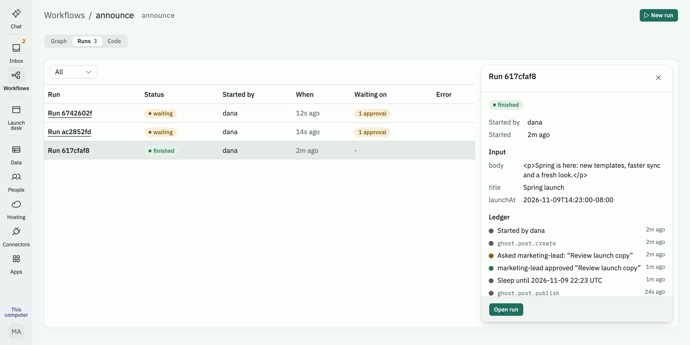

Open **Workflows** to start a run or investigate an earlier one. For a guided exercise with known inputs and results, [run your first workflow](/start/first-workflow/).

## Workflows

Search by title or workflow name. Use the app tabs if several apps have similarly named workflows. Select **Waiting on you** to find a run that needs your decision, or **Failed last run** to investigate a recent failure.

## Start a live or sandbox run

1. Open the workflow and choose **New run**.
2. Choose **Sandbox** to use a scenario’s fixed input and fake vendors. Pick the scenario and inspect the input. This option is available when the workflow has a scenario. The app starts the run as you.
3. For a live call, choose **Live vendors** instead. Review which vendors the run calls and what policy will require. Enter the input, leaving optional fields empty to use their defaults. If validation fails, correct the marked fields.
4. Choose **Start sandbox run** or **Start run**. Sanoma opens the run page.

## Inspect a run

Open the workflow’s **Runs** tab, select the row, and choose **Open run**. If you don’t know which workflow ran, use **Workflows → All runs** and filter by status.

- **Waiting.** Select **Show approval** to see who can decide and which operations the request covers. [Review the approval](/using-the-app/approvals/) if it’s addressed to you.
- **Failed.** Read the error and find the corresponding call in **Ledger**. Choose **Show in graph** to inspect its input, output, and the policy decision. Open **Code** to see the matching source lines.
- **Sandbox.** Read **Checks** above the ledger. A failed check gives its reason. A check marked **not yet** can still change while the run is waiting. See [how sandbox checks work](/testing/sandbox-runs/).

<a id="workflow-screens" href="/reference/workflow-screens/">Workflow tabs, filters, and run URLs</a>
