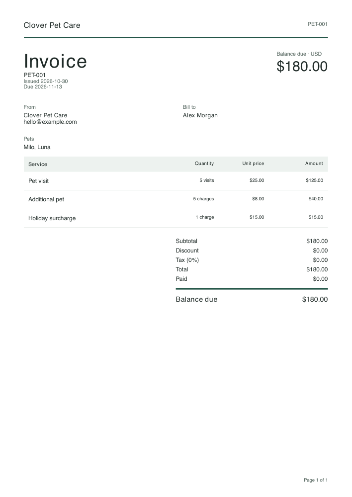

# @sanoma-ai/invoices

Portable invoice validation, calculation and React PDF rendering for browser tools and headless workflows. Pet-sitting and cleaning adapters turn industry-specific inputs into one invoice model. The root model entry imports no React or renderer code. PDF entry points use React and `@react-pdf/renderer`; React 19 is a peer dependency. No entry point uses a database or stores invoices.

```sh
pnpm add @sanoma-ai/invoices
```

```ts
import { calculateInvoice, petSittingInvoice, formatMoney } from "@sanoma-ai/invoices";
import { petSittingExample } from "@sanoma-ai/invoices/examples";

const invoice = petSittingInvoice(petSittingExample);
const result = calculateInvoice(invoice);
formatMoney(result.totals.dueMinor, invoice.currency, invoice.locale); // $180.00
```

## Contract

`InvoiceInput` contains an explicit invoice number, issue date, issuer, recipient, currency and line items. Each line supplies a description, unit, quantity and unit price. Optional fields include a due date, service period, service address, notes, a flat discount, tax percentage and payment already received. Billing and service addresses are independent. Optional `details` are bounded plain-text label/value pairs; the core schema contains no industry-specific fields. `invoiceSchema` describes the canonical runtime contract; `Invoice` is its validated output with defaults applied. `schemaVersion` is currently `1`.

Quantities and monetary values are **decimal strings**, never JavaScript numbers. Inputs are not coerced: an empty price is invalid, not zero. Quantities must be positive with up to six integer and four fractional digits. Prices, discounts and payments allow up to nine integer and four fractional digits. Discounts and payments must be representable in the currency's minor unit (trailing zeroes are accepted). Prices may have extra precision because each line is rounded after multiplying by quantity.

Supported currencies are USD, EUR, GBP, AUD and CAD (two decimal places), JPY (zero) and KWD (three). Supported formatting locales are `en-US`, `en-GB`, `de-DE` and `fr-FR`. Text remains caller-supplied; locale does not translate descriptions. Calendar dates use `YYYY-MM-DD`, with no timezone conversion. Due dates and service periods cannot run backwards.

`calculateInvoice(input)` validates unknown input and returns the normalized invoice, calculated lines and totals as safe integer minor units. BigInt arithmetic applies these rules:

1. Multiply each decimal quantity by its decimal unit price and round half up to the currency's minor unit.
2. Sum the rounded line amounts, then subtract the flat discount.
3. Calculate tax on that discounted subtotal and round half up once.
4. Add tax, then subtract the amount paid to get the balance due.

Negative values, discounts exceeding the subtotal, payments exceeding the total, tax over 100%, and amounts exceeding JavaScript's safe integer range are rejected. This version does not model credits, multiple tax rates, inclusive tax or jurisdiction-specific tax rules. It does not allocate invoice numbers or send, store or collect invoices.

`formatMoney(minor, currency, locale?)` formats safe integer minor units without converting the major amount to floating point.

## Industry inputs

`petSittingInvoice(input)` accepts pets and service rows (visit, walk, overnight, additional pet, holiday or other). It supplies default descriptions and units, but never assumes a price. `cleaningInvoice(input)` accepts a property description and service rows (standard, deep, move-out, oven, refrigerator, windows or other), with job, hour or visit units. Both return canonical invoices using the same validation and calculation rules. Custom descriptions override preset labels.

`petSittingSchema` and `cleaningSchema` expose structural validation for forms. Final validation goes through the adapters, which also enforce cross-field and arithmetic constraints; parsing any schema (including `invoiceSchema`) alone is not sufficient to enable a download or run an operation.

The separate `@sanoma-ai/invoices/examples` entry point exports fictional `petSittingExample` ($180), `residentialCleaningExample` ($240) and `commercialCleaningExample` ($960) inputs. Commercial cleaning uses the cleaning adapter with visits and distinct billing/service addresses; there is no third invoice engine.

## Errors and boundaries

Calculation and adapter failures throw `InvoiceValidationError`, with `code: "invalid_invoice"` and serializable `issues: { code, path, message }[]`. Paths identify fields, including row indices. Adapters map calculation paths back to their `services` rows. Errors do not include submitted field values. Unexpected programming failures are not converted to validation errors.

The package performs no persistence. A browser consumer can keep form state in memory and use native autocomplete; saving data or arranging automation belongs to a separate Sanoma experience. The browser editor and durable workflow operation are separate follow-up surfaces.

## PDF rendering



```ts
import { renderInvoice } from "@sanoma-ai/invoices/browser";
// In Node use the same API from "@sanoma-ai/invoices/node" instead.
import { petSittingInvoice } from "@sanoma-ai/invoices";
import { petSittingExample } from "@sanoma-ai/invoices/examples";

const file = await renderInvoice(petSittingInvoice(petSittingExample));
// { bytes: Uint8Array, mediaType: "application/pdf", filename, summary }
const blob = new Blob([new Uint8Array(file.bytes)], { type: file.mediaType });
```

Both renderers use the same React document layout and calculations. The result includes calculated totals and a sanitized suggested filename. It contains bytes, not a checkpoint-ready base64 envelope; workflow serialization belongs to the workflow adapter. Object URLs, preview scheduling and downloads belong to the browser consumer. No URL is created or retained here.

`@sanoma-ai/invoices/pdf` exports the validated `InvoiceDocument({ input, options? })` component, `createInvoiceDocument(input, options?)` (document, filename and summary), `pdfOptionsSchema`, `pdfLimits`, and `InvoiceRenderError`. Prefer the browser/Node render functions when you need a complete PDF file. Every public document entry validates invoice data and assets; callers cannot supply arbitrary image URLs.

The standard layout uses `invoice.presentation.paper` (`A4` or `LETTER`) and `accent` (six-digit hex). It shows parties, separate billing/service addresses, service dates and units, labeled details, adjustments, payments and balance due. It repeats headers and page numbers, keeps each service row together, and allows long notes to flow across pages. Invoice numbers and dates are explicit inputs. PDF metadata dates derive from the issue date; byte-identical files are not a compatibility promise.

The explicit font is built-in Helvetica/Helvetica-Bold: printable ASCII, Latin-1 and the WinAnsi punctuation listed in `src/render-contract.ts`. Text outside that set, including emoji, decomposed accents and other writing systems, produces an `unsupported_text` field error. Supported formatting locales do not imply support for every character in those languages. Fonts are not downloaded at render time.

Optional branding accepts `{ logo: { mediaType: "image/png", base64 } }` as the second render argument. Supply plain base64 bytes, not a URL or data URI. The supported image format is non-interlaced 8-bit RGB/RGBA PNG, at most 256 KiB and 1024 pixels per side. Compressed pixels are bounded before decoding; PNG CRCs are checked and ancillary metadata is stripped before re-encoding. Color-key transparency (`tRNS`) is rejected; use RGBA for transparency. Other image formats require conversion before calling this API.

PDF limits are narrower than the model: at most 100 rows, 30,000 text characters and 5 MiB output. Service descriptions must fit a conservative 40-line budget (20 characters per estimated line, preserving explicit newlines). Longer detail belongs in Notes. Names, invoice identifiers and other single-line fields reject tabs/newlines. `InvoiceValidationError` reports input, glyph, asset and layout-limit problems with canonical field paths; `InvoiceRenderError` reports `render_failed` or `output_too_large`. Neither failure returns a partial PDF.

The renderer is substantial browser code, so load `/browser` on demand. Debounce valid preview inputs and prevent stale results from replacing newer ones; measure real devices before deciding whether to move rendering to a worker.

## Development

From the repository root, run `pnpm exec vitest run packages/invoices/test`, `pnpm --filter @sanoma-ai/invoices build`, and the root typecheck, lint and format checks. The package has its own JSX/DOM typecheck, included in root `pnpm typecheck`. The tests use no database.

Run `pnpm --filter @sanoma-ai/invoices smoke:browser /tmp/invoice-proof` with Google Chrome installed (or `CHROME_PATH` set). This packs and extracts the package, bundles a consumer without source aliases, and compares real browser/Node PDF text, dimensions, pagination, totals and filenames. It rejects Node-only bundle modules and external asset fetches, and writes PDF evidence and timings. Mobile measurements use a 390px viewport and 4x CPU throttling; they are not physical-device results.

A local verification on 2026-10-30 (macOS arm64, Node 26.12.1, Chrome 156.0.8078.76, React-pdf 4.9.0) measured a 1,329,433-byte minified consumer bundle including fixtures. The three one-page examples took 12–73 ms in Chrome; the 40-row, nine-page example took 104 ms. At 4x CPU throttling they took 45–106 ms and 466 ms respectively. These are single local runs, not throughput benchmarks or mobile-device guarantees. The four examples plus a French-currency/PNG-logo case matched Node's extracted content, page dimensions/counts and totals; final PDFs were also rasterized for visual inspection.

The `@sanoma-ai/invoices/pdf-contract` entry exports PDF option validation, limits and error types without loading the React PDF engine. Workflow execution is provided separately by [`@sanoma-ai/connector-invoices`](../../connectors/invoices/README.md), whose bounded JSON result is suitable for durable checkpoints.
