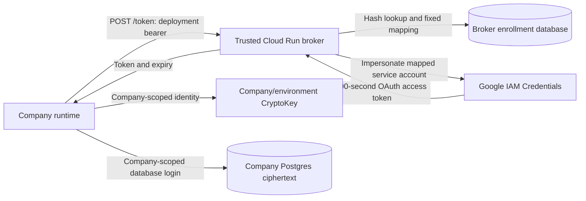
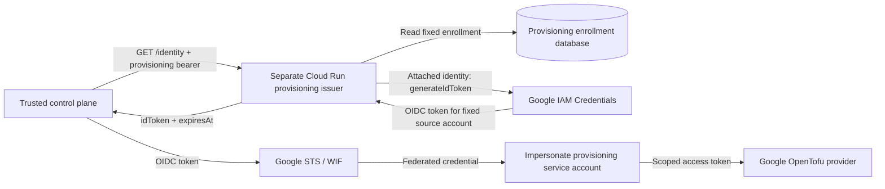

# Managed Cloud identity

`@sanoma-ai/workflows/cloud-identity` supplies the identity-broker handler and refreshable Google SDK authentication for [D1, #492](https://github.com/Sanoma-AI/sanoma/issues/492). It is a reusable implementation boundary. Isolated live checks on a temporary Cloud Run service in `sanoma-513217` have verified attached-identity issuance, scoped KMS use and separate database permissions; production deployment remains open.

Runtime and provisioning identity are separate trust boundaries. `identityBroker` issues ten-minute OAuth access tokens for company runtimes. `provisioningIdentityBroker` supplies Google-issued OIDC tokens for the control plane’s Workload Identity Federation (WIF) flow. Deploy them with separate attached accounts, enrollment databases/readers and bootstrap credentials. Sharing handler code does not establish that separation. Neither handler reads company credential rows or unwraps data keys.

## Request and authority



`identityBroker` accepts **POST `/token`**, with `Authorization: Bearer <deployment credential>`, no query string and no request body. Do not send `{}`. The request cannot select company, service account, key, scope or token lifetime. Wrong routes/methods return 404, a query/body returns 400, invalid enrollment returns 401, and dependency/audit failures return a sanitized 503. Responses prohibit caching.

The broker hashes the bearer, loads its active enrollment, issues for the mapped service account, then checks the enrollment again before delivery. `postgresIdentityEnrollments` reads on each check; it does not cache enrollment authority. Audit must durably record issuance/denial/unavailability metadata, never tokens or authorization headers. Failure to record a successful issuance prevents delivery, even if Google already minted the token.

`attachedGoogleTokenIssuer` explicitly uses the Cloud Run attached identity through `google-auth-library`'s `Compute` client. It requests `generateAccessToken` for the enrollment's service account, with the fixed `cloud-platform` scope and `600s` lifetime. It returns an OAuth API access token, not an OIDC ID token. No service-account private key or ambient credential-file fallback is used. The attached account needs `iam.serviceAccounts.getAccessToken` on the intended target accounts; this permission is documented by [Google IAM Credentials](https://docs.cloud.google.com/iam/docs/reference/credentials/rest/v1/projects.serviceAccounts/generateAccessToken).

The broker's attached identity must have no company database access, direct KMS decrypt grant or IAM-policy mutation authority. Each target service account must have encrypt/decrypt access only to its company/environment key, with no inherited fleet grants or impersonation authority. These are deployment requirements; constructing the handler does not establish them.

## Enrollment database and role separation

Install `CLOUD_IDENTITY_SQL` with an administrator in a **broker-owned database**, never a company database. It creates `sanoma_identity.deployments` (deployment → company/environment/service account and enabled state) and `sanoma_identity.credentials` (SHA-256 hash, deployment, positive generation, validity interval and revoked state). It revokes public schema/table access. It does not create logins or grant broker/provisioner privileges.

Example roles, to adapt and install with administrative authority:

```sql
-- Synthetic role names; supply login authentication through protected deployment setup.
CREATE ROLE identity_broker_reader NOLOGIN;
CREATE ROLE identity_enrollment_writer NOLOGIN;
GRANT USAGE ON SCHEMA sanoma_identity
  TO identity_broker_reader, identity_enrollment_writer;
GRANT SELECT ON sanoma_identity.deployments, sanoma_identity.credentials
  TO identity_broker_reader;
GRANT SELECT, INSERT, UPDATE
  ON sanoma_identity.deployments, sanoma_identity.credentials
  TO identity_enrollment_writer;
-- Separate pre-created logins, neither superuser nor schema/table owner:
GRANT identity_broker_reader TO example_broker_login;
GRANT identity_enrollment_writer TO example_provisioner_login;
```

The broker login must have no writer-role membership, inherited write grants or authority to grant itself privileges. The provisioning login stays outside company runtimes and outside the broker's serving process. Database connection/authentication is separate bootstrap material; it cannot be fetched from the same service it unlocks.

### Provisioning operations

The trusted control-plane config supplies `identityProvisioning` with a `secret()` reference to its enrollment-writer URL and the maximum credential validity. Company runtimes and the serving broker do not receive this writer. Install `CLOUD_IDENTITY_SQL` separately with administrative authority, then configure the control plane:

```ts
import { defineConfig } from "sanoma";
import { secret } from "sanoma/resources";

export default defineConfig({
  connectors: [], // Add the control plane's configured vendor connectors.
  identityProvisioning: {
    databaseUrl: secret("IDENTITY_WRITER_URL"),
    maxValidityMs: 24 * 60 * 60 * 1000,
  },
});
```

Enter the URL under that name on the app's Hosting page (Connect), where the enrollment writer is listed as missing until it is stored. The value lives in the control plane's secret store, never in source, an environment variable, workflow inputs/results or logs. It is read when an enrollment operation first uses the writer, inside that operation, and again on each use, so a replaced value takes effect on the next enrollment without a restart; config resolution and descriptions perform no I/O and never read it. Without a stored value, enrollment fails with "the enrollment writer is not set" and is not retried. A malformed URL is refused with a sanitized error. Remote Postgres connections require verified TLS. Each client and worker owns a separate, lazy enrollment pool and closes it on shutdown or startup failure. There is no fallback to the company database, the broker reader or the environment. A plain string `databaseUrl` is still accepted and checked at config load, for composition that holds the URL some other trusted way.

Before writes, the managed pool checks that its login has schema USAGE and SELECT, INSERT and UPDATE on both enrollment tables. It refuses schema CREATE, table DELETE, TRUNCATE, REFERENCES or TRIGGER, and superuser, create-role, create-database or bypass-RLS authority. Use a dedicated restricted login rather than a database owner; effective inherited permissions also matter.

The one-day limit is illustrative; choose a validity and renewal policy for the deployment. `maxValidityMs` is required and enforced against the enrollment database clock. This configuration does not install schemas, create roles, provision IAM, deliver credentials or schedule renewal.

Trusted composition that already owns a writer pool may instead supply the low-level `IdentityProvisioning` adapter:

```ts
import { postgresIdentityProvisioning } from "@sanoma-ai/workflows/cloud-identity";
import { databaseOn } from "@sanoma-ai/workflows/db";

const enrollmentWriter = databaseOn(enrollmentWriterPool);
const identityProvisioning = postgresIdentityProvisioning(async () => enrollmentWriter, {
  maxValidityMs: 24 * 60 * 60 * 1000,
});
// Supply this adapter as defineConfig's identityProvisioning value.
// Its caller owns pool shutdown, TLS and permission validation.
```

An explicitly supplied adapter stays caller-owned; Sanoma does not close it or apply the managed pool's connection and permission checks.

Workflows declare the built-in `sanoma.identity.enroll`, `.retire` and `.revoke` operations in `uses`. They pass through the existing policy and ledger path; direct calls are refused. All three identify the same fixed mapping: `deployment`, `company`, `environment` and `serviceAccount`. The workflow and policy must authorize the actor against that company and environment before granting access.

| Operation | Additional input                    | Result and behavior                                                                                                                                                                         |
| --------- | ----------------------------------- | ------------------------------------------------------------------------------------------------------------------------------------------------------------------------------------------- |
| `enroll`  | `generation`, `validUntil`, `store` | Ensures a random bootstrap credential in the selected secret store, enrolls its SHA-256 hash and returns `{ deployment, generation, store }`. No bearer or hash enters the workflow result. |
| `retire`  | `generation`, `validUntil`          | Shortens a generation's validity without extending it; a deadline at or before the database's current time revokes it. Returns `{}`.                                                        |
| `revoke`  | None                                | Disables renewal for every generation of the deployment. This is terminal for that deployment ID. Returns `{}`.                                                                             |

Use a distinct secret name for each deployment and generation, such as `ACME_PRODUCTION_BOOTSTRAP_G1`. A higher generation must use a new credential; reusing an enrolled hash is refused. Neither rotation nor retry may change the deployment's company, environment or service account.

Enrollment writes take a deployment-row lock, so concurrent enrollment, retirement and revocation serialize. A retry with the same mapping, generation, hash and still-valid deadline succeeds. A changed or retired deadline, revoked credential, disabled deployment, reused hash or lower unused generation is refused. If the database response is lost after commit, retry with the original inputs and secret name; the stored credential is retained. Do not delete or replace that secret while the outcome is uncertain. A failed enrollment can leave an inactive secret; reconcile the enrollment before removing it.

Rotation consists of enrolling a higher generation under a new secret name, securely delivering it, verifying renewal with it, then retiring the old generation with a bounded overlap deadline. These operations do not perform delivery or readiness verification. Revocation stops further issuance, but already issued Google tokens can remain usable until their expiry.

Database failures are sanitized and classified as unavailable; invalid inputs and conflicting enrollment state are not retryable. There is no HTTP enrollment endpoint. Sandbox runs use separate in-memory enrollment authority and never touch the live enrollment database; they do not validate the deployment-specific maximum validity.

Restore enrollment backups carefully so revoked credentials do not become active again. Bootstrap values remain in the selected secret store and the deployment's protected delivery channel; the enrollment database stores only their hashes.

Broker composition uses its read-only database pool and a separate durable audit sink:

```ts
import {
  identityBroker,
  postgresIdentityEnrollments,
  attachedGoogleTokenIssuer,
} from "@sanoma-ai/workflows/cloud-identity";
import { databaseOn } from "@sanoma-ai/workflows/db";

const brokerReader = databaseOn(brokerReadOnlyPool);
const handle = identityBroker({
  enrollments: postgresIdentityEnrollments(async () => brokerReader),
  issue: attachedGoogleTokenIssuer(),
  audit: writeDurableIdentityAudit,
});
// The deployment's HTTP server passes the incoming Request to handle.
// Pool, audit sink and server lifecycle belong to trusted deployment composition.
```

## Runtime refresh and KMS integration

Create one `cloudIdentityAuth` client per runtime deployment. It returns an `OAuth2Client` whose refresh handler coalesces concurrent renewal requests and renews 60 seconds before expiry. Each renewal calls the bootstrap reader again, so mounted-credential rotation can take effect without caching the old bearer. Tokens remain only in that client's memory. The endpoint must be HTTPS `/token`, with no embedded credentials, query or fragment; redirects are refused. Broker calls time out after ten seconds, malformed/near-expiry replies fail, and errors expose no response body or credential. There is no fallback identity.

The following composition joins D1 to the separate [#470 KMS adapter](https://github.com/Sanoma-AI/sanoma/issues/470); it requires both entries to be available in the installed package. Company database/key provisioning remains separate:

```ts
import { readFile } from "node:fs/promises";
import { KeyManagementServiceClient } from "@google-cloud/kms";
import { cloudIdentityAuth } from "@sanoma-ai/workflows/cloud-identity";
import { databaseOn } from "@sanoma-ai/workflows/db";
import { kmsPostgresStore } from "@sanoma-ai/workflows/kms-secrets";

const companyDatabase = databaseOn(companyScopedPool);
const authClient = cloudIdentityAuth({
  endpoint: "https://identity.example.test/token",
  credential: async () => (await readFile("/run/sanoma/deployment-credential", "utf8")).trim(),
});
const kms = new KeyManagementServiceClient({ authClient });
const store = kmsPostgresStore({
  company: "example-company", // Fixed by trusted bootstrap.
  keyName: "projects/example-project/locations/us-central1/keyRings/production/cryptoKeys/example-company",
  kms,
  database: async () => companyDatabase,
});
// Supply store to defineConfig's secrets configuration.
// The deployment owns kms.close() and the database pool lifecycle.
```

Credential ciphertext stays in the company's Postgres database. Caching the short-lived Google token does not authorize caching decrypted credential bundles or unwrapped data keys. App signing material remains independent. Neither this route nor the KMS adapter needs `SANOMA_SECRETS_KEY`.

## Isolated live verification

The verification used D1 source `244fb3e78c66c5d3d6bb22cacad73acbb1726cb3` and KMS source `c3c293d0bc48cbcf66adf8e0cb0c57f500e686bc`, with a temporary Cloud Run broker and separate disposable remote Postgres databases. The broker image contained the compiled handler and a small HTTP adapter; its attached service account had only `iam.serviceAccounts.getAccessToken` on three test runtime accounts. It had no company database credentials or direct KMS grant. Database enrollment used a read-only login and audit writes used a separate insert-only login.

The actual Google SDK and KMS store passed own-key encrypted writes/reads, company A/B and production/preview encrypt/decrypt denial, separate company-database access checks, enrollment-write refusal, invalid bearer and caller-target override refusal. Revoking the broker's enrollment-read or audit-insert permission caused a sanitized 503 without a delivered token; restoring the permission restored service. These are permission-failure checks, not a measurement of provider-wide outages.

A manual primary-version rotation kept old ciphertext readable and new writes adopted the new primary after propagation. Revoking a deployment credential rejected new issuance while the SDK's already issued token continued working until renewal. The ten-minute runtime renewal result is tracked in [#492](https://github.com/Sanoma-AI/sanoma/issues/492), separately from [provisioning OIDC verification](../../connectors/gcp/README.md#testing-and-current-evidence).

This proof uses test infrastructure and compiled source, not published-package consumption in sanoma-ops. Cloudflare cold start/resume, bootstrap delivery, production monitoring/quotas, IAM/KMS audit reconciliation and backup recovery remain rollout gates.

## Residual authority and rollout gates

Possession of the deployment bearer proves possession, not host attestation. A stolen bearer can renew that deployment's tokens while its enrollment remains active. Revoking enrollment stops subsequent renewal checks; **already issued tokens can remain usable until expiry**. IAM changes have their own propagation behavior, and neither revocation nor expiry recalls plaintext already obtained.

A compromised broker can impersonate every service account its attached identity may mint for. Per-company keys do not remove that fleet-level issuer risk. A compromised enrollment writer can change mappings within the broker's permitted targets. Keep both outside company-authored code and public company Workers; give each company runtime only its own bearer, database authority and key access.

Before rollout:

- Provision the Cloud Run service, attached issuer account, broker database roles, durable audit sink and per-company/environment keys and service accounts. Enable billing and required APIs. The temporary verification deployment below does not provision a production service.
- Make the TLS endpoint reachable without first demanding a Google invocation token; the application bearer authenticates it. This requires an explicit [Cloud Run invocation configuration](https://docs.cloud.google.com/run/docs/authenticating/public), plus appropriate request limits and quota monitoring. Do not add this endpoint to a company Worker that holds fleet authority.
- Deliver each bootstrap credential only to its intended deployment. For Cloudflare, explicitly pass its protected Worker binding to that company's container. Prove cold start, resume, refresh through token expiry, bounded credential rotation, revoked/expired generations and broker/audit outages.
- Prove company A's bearer cannot select B via body/query, A's token cannot use B's key, A's database login cannot read B's rows, and preview cannot access production. Synthetic handler tests are insufficient evidence for Google IAM or database isolation.
- Verify issuance and KMS audit attribution, credential/header redaction, service quotas, backup recovery and retained key versions. Record the actual deployment evidence before declaring D1 or managed Cloud ready.

## Provisioning identity from a non-Google host

The trusted control plane can obtain renewable provisioning credentials without a service-account private key:



Three identities have different responsibilities:

- The **attached issuer account** has `iam.serviceAccounts.getOpenIdToken` on the fixed source account only.
- The **source account** identifies the control plane to WIF through its immutable numeric Google `uniqueId`; it needs no infrastructure-administration roles.
- The **provisioning account** receives scoped infrastructure permissions and grants impersonation only to the intended WIF principal.

Trusted `ProvisioningIdentity` configuration fixes the source `serviceAccount`, numeric `subject` and exact WIF provider `audience`. Configure WIF for issuer `https://accounts.google.com`, map `google.subject` from `assertion.sub`, and restrict trust to the intended subject and audience. The source and target provisioning accounts are different identities.

`provisioningIdentityBroker` accepts **GET `/identity`** with a provisioning bearer, no query and no body. Its enrollment must map to the configured source account. The caller cannot select an account, audience or lifetime. It checks enrollment before issuance and before delivery; audit failure prevents delivery. Responses contain only `{ idToken, expiresAt }` and prohibit caching.

`attachedGoogleIdTokenIssuer(identity)` uses the attached `Compute` identity to call [Google’s generateIdToken API](https://docs.cloud.google.com/iam/docs/reference/credentials/rest/v1/projects.serviceAccounts/generateIdToken). It validates returned claims and expiry; Google STS verifies the token signature during federation. This trusted callback does not accept caller-supplied JWTs.

```ts
import {
  provisioningIdentityBroker,
  attachedGoogleIdTokenIssuer,
  postgresIdentityEnrollments,
} from "@sanoma-ai/workflows/cloud-identity";
import { databaseOn } from "@sanoma-ai/workflows/db";

const provisioningReader = databaseOn(provisioningReadOnlyPool);
const identity = {
  serviceAccount: "provision-source@example-project.iam.gserviceaccount.com",
  subject: "123456789012345678901",
  audience:
    "//iam.googleapis.com/projects/123456789012/locations/global/workloadIdentityPools/provision/providers/google",
};
const handle = provisioningIdentityBroker({
  identity,
  enrollments: postgresIdentityEnrollments(async () => provisioningReader),
  issue: attachedGoogleIdTokenIssuer(identity),
  audit: writeDurableProvisioningAudit,
});
```

The pool and audit sink belong to this separate service. The control plane reaches it through the GCP connector's [`gcpWithIdentity`](../../connectors/gcp/README.md#deployment-identity): the issuer URL, audience and target account are declared in code, and the provisioning bearer is the `gcp/provisioning` connection's stored credential, entered on the Google Cloud connector page. Each call builds the external-account URL source from those in memory for the Node verifier and the Google provider; the configuration never enters source control, workflow inputs/results or logs.

Google-issued OIDC tokens last up to **one hour**. A ten-minute final impersonated access token does not shorten that lifetime. Revoking enrollment stops new issuance, but an issued OIDC or federated credential may still obtain access tokens. Incident revocation must also remove federation and/or target impersonation trust, accounting for IAM propagation and access tokens already issued. These helpers do not implement that IAM revocation workflow. The runtime route remains POST `/token` with ten-minute OAuth access tokens.

### Evidence and remaining integration

An isolated live check in `sanoma-513217` verified Google-issued OIDC tokens, STS exchange, scoped impersonation and rejection of another subject and target. The observed OIDC lifetime was 3,600 seconds. Temporary federation and service accounts were removed. Local tests cover both broker routes and Google’s URL-source exchange using synthetic transports.

This establishes the Google trust path, not a deployed provisioning broker or provider renewal through that broker. Deploying the separate issuer/enrollment/audit boundary and proving renewal and revocation through the actual host remain [#532](https://github.com/Sanoma-AI/sanoma/issues/532); enrolling and rotating the stored provisioning bearer is by hand until [#701](https://github.com/Sanoma-AI/sanoma/issues/701).

## Standalone identity service

`sanoma identity` serves one broker mode from its host's configuration. That configuration, its enrollment-reader and audit-writer database URLs among it, belongs to the service's own host (a Cloud Run service), not to a company: no company config, connector page or secret store holds it, and a company's runtime never receives it. It loads no company config, `.env`, workflows or sites, starts no worker, and creates no database or schema. Deploy runtime and provisioning modes as separate services with separate attached identities, enrollment readers, bootstraps and audit boundaries; a mode flag alone does not establish that separation.

| Setting                              | Purpose                                                                                                             |
| ------------------------------------ | ------------------------------------------------------------------------------------------------------------------- |
| `SANOMA_IDENTITY_MODE`               | Required: `runtime` or `provisioning`.                                                                              |
| `SANOMA_IDENTITY_READ_DATABASE_URL`  | Required protected enrollment-reader connection string.                                                             |
| `SANOMA_IDENTITY_AUDIT_DATABASE_URL` | Required protected audit-writer connection string.                                                                  |
| `SANOMA_IDENTITY_HOST`               | Listening address, default `0.0.0.0` for the command.                                                               |
| `SANOMA_IDENTITY_CONCURRENCY`        | Maximum in-flight broker requests, default `32`, allowed `1`–`256`; excess requests receive 429 with a retry delay. |
| `PORT`                               | Listening port, default `8080`; `3000` in the runtime image, and Cloud Run sets it to the container port.           |
| `SANOMA_IDENTITY_SOURCE_ACCOUNT`     | Provisioning only: fixed source service-account email.                                                              |
| `SANOMA_IDENTITY_SOURCE_SUBJECT`     | Provisioning only: its immutable numeric Google `uniqueId`.                                                         |
| `SANOMA_IDENTITY_AUDIENCE`           | Provisioning only: exact WIF provider audience.                                                                     |

Supply connection strings through the host's protected deployment mechanism. Never put them in source, resource plans, workflow inputs/results or logs. Runtime mode serves POST `/token`; provisioning mode serves GET `/identity`. Both require the corresponding enrollment bearer, use an attached Google identity and expose no enrollment endpoint. Put the HTTP listener behind HTTPS ingress, such as Cloud Run's TLS endpoint.

An administrator installs `CLOUD_IDENTITY_SQL` from `@sanoma-ai/workflows/cloud-identity` in the enrollment database and `CLOUD_IDENTITY_AUDIT_SQL` from `@sanoma-ai/workflows/identity-service` in the audit database. The service performs no DDL. The enrollment login needs schema USAGE and SELECT on the two enrollment tables, with no table mutation or schema CREATE privileges. The audit login needs schema USAGE and INSERT on `sanoma_identity.audit_events`, with no SELECT, UPDATE, DELETE, TRUNCATE, REFERENCES, TRIGGER or schema CREATE privileges. For example, in the audit database:

```sql
CREATE ROLE identity_audit_writer NOLOGIN;
GRANT USAGE ON SCHEMA sanoma_identity TO identity_audit_writer;
GRANT INSERT ON sanoma_identity.audit_events TO identity_audit_writer;
GRANT identity_audit_writer TO example_audit_login;
```

Create the login and deliver its authentication separately. Neither serving role may be superuser, create roles/databases, bypass RLS or inherit the disallowed privileges. Startup checks these role and table/schema permissions and refuses excessive authority. Keep schema ownership and enrollment writes with separate administrative/provisioning identities.

Audit rows contain fixed issuance metadata: result, deployment, company, environment, service account, generation and expiry. They contain no tokens, bearer hashes, authorization headers or arbitrary request fields. Audit failure prevents token delivery and returns a sanitized error; recovery never switches identities.

The liveness route uses `/health`: [Cloud Run reserves some paths ending in `z`](https://docs.cloud.google.com/run/docs/known-issues#reserved-url-paths), so `/healthz` may be intercepted before it reaches the service; the service answers it too, for the runtime image's Docker health check. GET or HEAD `/health` and the launcher's `ready` event mean the process is listening. They do **not** prove current Google issuance, continuing database/audit availability, provider renewal or managed-store readiness. Before declaring a company ready, verify its deployed runtime can write and read a credential under its own key/database identity. The two-company, preview/production, renewal, cold-start, outage and recovery checks remain #532 gates.

Trusted programmatic composition may call `startIdentityService(options)` from `@sanoma-ai/workflows/identity-service`, returning `{ url, stop }`. Its default host is loopback; the caller owns shutdown. The serving package does not load company code.

### Deploying the issuers

The published [runtime image](../sanoma/README.md#hosting-it-yourself), `ghcr.io/sanoma-ai/runtime:<sanoma version>`, runs the service with the command `identity` (from `sanoma` 0.11.21): it checks out no company and runs that release's `sanoma identity` as the non-root `node` user. Cloud Run deploys public GitHub Container Registry images as they are ([Cloud Run: supported container registries](https://docs.cloud.google.com/run/docs/deploying#images), page updated 2026-10-30), so a Cloud Run v2 service names that image directly, with no Artifact Registry copy; the release never replaces a version's tag, and Cloud Run records the digest it resolved in each revision. Google recommends an Artifact Registry remote repository in front of GitHub Container Registry for higher availability; later, if pulls prove unreliable.

A `gcp.cloudRunService` declaration for the provisioning mode:

```ts
import { gcp } from "@sanoma-ai/connector-gcp/resources";

const connection = { vendor: "gcp", $connection: "gcp/provisioning" } as const;
const fromSecretManager = (name: string, secret: string) => ({
  name,
  value_source: { secret_key_ref: { secret, version: "latest" } },
});
export const provisioningIssuer = gcp.cloudRunService(
  {
    project: "example-project",
    location: "us-central1",
    name: "identity-provisioning",
    ingress: "INGRESS_TRAFFIC_ALL",
    // The bearer authenticates each request; Cloud Run's invoker check is off for this service.
    invoker_iam_disabled: true,
    template: {
      service_account: "identity-issuer@example-project.iam.gserviceaccount.com",
      containers: [
        {
          image: "ghcr.io/sanoma-ai/runtime:0.11.21",
          args: ["identity"],
          ports: { container_port: 8080 },
          env: [
            { name: "SANOMA_IDENTITY_MODE", value: "provisioning" },
            {
              name: "SANOMA_IDENTITY_SOURCE_ACCOUNT",
              value: "provision-source@example-project.iam.gserviceaccount.com",
            },
            { name: "SANOMA_IDENTITY_SOURCE_SUBJECT", value: "123456789012345678901" },
            {
              name: "SANOMA_IDENTITY_AUDIENCE",
              value:
                "//iam.googleapis.com/projects/123456789012/locations/global/workloadIdentityPools/provision/providers/google",
            },
            fromSecretManager("SANOMA_IDENTITY_READ_DATABASE_URL", "identity-provisioning-reader"),
            fromSecretManager("SANOMA_IDENTITY_AUDIT_DATABASE_URL", "identity-provisioning-audit"),
          ],
          startup_probe: { http_get: { path: "/health" } },
        },
      ],
    },
  },
  { connection },
);
```

Runtime mode is a second service like it, with `SANOMA_IDENTITY_MODE: "runtime"` and without the three provisioning settings. The two database URLs are Secret Manager secrets of the service's project, read by its attached account at start: the declaration names them, never their values. Neither the service tests nor the image's CI check substitutes for live deployment verification.
