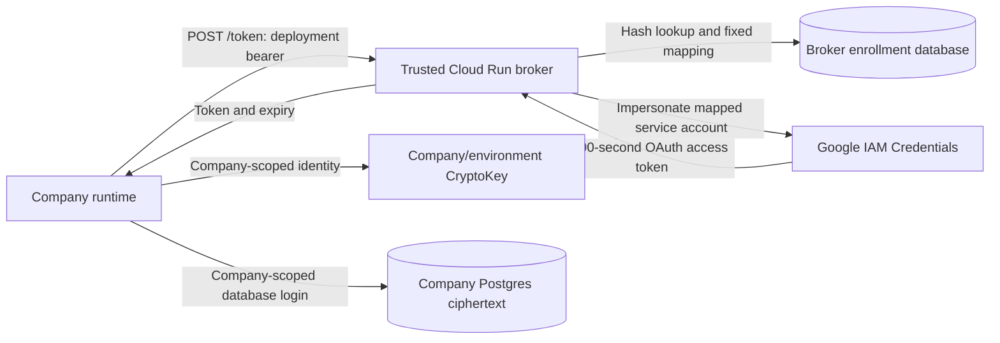

# Managed Cloud runtime identity

`@sanoma-ai/workflows/cloud-identity` supplies the identity-broker handler and refreshable Google SDK authentication for [D1, #492](https://github.com/Sanoma-AI/sanoma/issues/492). It is a reusable implementation boundary. Isolated live checks on a temporary Cloud Run service in `sanoma-513217` have verified attached-identity issuance, scoped KMS use and separate database permissions; production deployment remains open.

This runtime route is separate from the provisioning OIDC identity in [#489](https://github.com/Sanoma-AI/sanoma/issues/489). Provisioning manages enrollment and infrastructure. The company runtime receives only its deployment's bootstrap credential and short-lived access tokens. The broker issues identity; it does not read company credential rows, decrypt credentials or unwrap data keys.

## Request and authority



`identityBroker` accepts **POST `/token`**, with `Authorization: Bearer <deployment credential>`, no query string and no request body. Do not send `{}`. The request cannot select company, service account, key, scope or token lifetime. Wrong routes/methods return 404, a query/body returns 400, invalid enrollment returns 401, and dependency/audit failures return a sanitized 503. Responses prohibit caching.

The broker hashes the bearer, loads its active enrollment, issues for the mapped service account, then checks the enrollment again before delivery. `postgresIdentityEnrollments` reads on each check; it does not cache enrollment authority. Audit must durably record issuance/denial/unavailability metadata, never tokens or authorization headers. Failure to record a successful issuance prevents delivery, even if Google already minted the token.

`attachedGoogleTokenIssuer` explicitly uses the Cloud Run attached identity through `google-auth-library`'s `Compute` client. It requests `generateAccessToken` for the enrollment's service account, with the fixed `cloud-platform` scope and `600s` lifetime. It returns an OAuth API access token, not an OIDC ID token. No service-account private key or ambient credential-file fallback is used. The attached account needs `iam.serviceAccounts.getAccessToken` on the intended target accounts; this permission is documented by [Google IAM Credentials](https://docs.cloud.google.com/iam/docs/reference/credentials/rest/v1/projects.serviceAccounts/generateAccessToken).

The broker's attached identity must have no company database access, direct KMS decrypt grant or IAM-policy mutation authority. Each target service account must have encrypt/decrypt access only to its company/environment key, with no inherited fleet grants or impersonation authority. These are deployment requirements; constructing the handler does not establish them.

## Enrollment database and role separation

Install `CLOUD_IDENTITY_SQL` with an administrator in a **broker-owned database**, never a company database. It creates `sanoma_identity.deployments` (deployment → company/environment/service account and enabled state) and `sanoma_identity.credentials` (SHA-256 hash, deployment, positive generation, validity interval and revoked state). It revokes public schema/table access. It does not create logins or grant broker/provisioner privileges.

Example roles, to adapt and install with administrative authority:

```sql
-- Synthetic role names; supply login authentication through protected deployment setup.
CREATE ROLE identity_broker_reader NOLOGIN;
CREATE ROLE identity_enrollment_writer NOLOGIN;
GRANT USAGE ON SCHEMA sanoma_identity
  TO identity_broker_reader, identity_enrollment_writer;
GRANT SELECT ON sanoma_identity.deployments, sanoma_identity.credentials
  TO identity_broker_reader;
GRANT SELECT, INSERT, UPDATE, DELETE
  ON sanoma_identity.deployments, sanoma_identity.credentials
  TO identity_enrollment_writer;
-- Separate pre-created logins, neither superuser nor schema/table owner:
GRANT identity_broker_reader TO example_broker_login;
GRANT identity_enrollment_writer TO example_provisioner_login;
```

The broker login must have no writer-role membership, inherited write grants or authority to grant itself privileges. The provisioning login stays outside company runtimes and outside the broker's serving process. Database connection/authentication is separate bootstrap material; it cannot be fetched from the same service it unlocks.

Trusted provisioning calls `createDeploymentCredential()` to generate 32 random bytes encoded as base64url plus its SHA-256 hash. Deliver the credential once through that deployment's protected secret channel; persist only its hash. Enrollment writes should be parameterized. For example, with synthetic deployment identifiers and the generated hash supplied as `$1`:

```sql
BEGIN;
INSERT INTO sanoma_identity.deployments
  (id, company, environment, service_account)
VALUES ('example-deployment', 'example-company', 'production',
        'runtime@example-project.iam.gserviceaccount.com');
INSERT INTO sanoma_identity.credentials
  (hash, deployment, generation, valid_from, valid_until)
VALUES ($1, 'example-deployment', 1, clock_timestamp(),
        clock_timestamp() + interval '1 day');
COMMIT;
```

The interval is illustrative. The SQL schema requires finite timestamps and checks that `valid_until` follows `valid_from`; provisioning must enforce its maximum validity and operational renewal policy. There is no HTTP enrollment endpoint.

For rotation, provision a new random credential under a higher unused generation, deliver it to the deployment, and set the old generation's `valid_until` to a bounded overlap deadline. Revoke a generation with `revoked = true`, or disable the deployment to prevent renewal for all its generations. Do not repoint an existing deployment to another company's service account as a credential-rotation shortcut. Restore enrollment backups carefully so revoked credentials do not become active again.

Broker composition uses its read-only database pool and a separate durable audit sink:

```ts
import {
  identityBroker,
  postgresIdentityEnrollments,
  attachedGoogleTokenIssuer,
} from "@sanoma-ai/workflows/cloud-identity";

const handle = identityBroker({
  enrollments: postgresIdentityEnrollments(async () => brokerReadOnlyPool),
  issue: attachedGoogleTokenIssuer(),
  audit: writeDurableIdentityAudit,
});
// The deployment's HTTP server passes the incoming Request to handle.
// Pool, audit sink and server lifecycle belong to trusted deployment composition.
```

## Runtime refresh and KMS integration

Create one `cloudIdentityAuth` client per runtime deployment. It returns an `OAuth2Client` whose refresh handler coalesces concurrent renewal requests and renews 60 seconds before expiry. Each renewal calls the bootstrap reader again, so mounted-credential rotation can take effect without caching the old bearer. Tokens remain only in that client's memory. The endpoint must be HTTPS `/token`, with no embedded credentials, query or fragment; redirects are refused. Broker calls time out after ten seconds, malformed/near-expiry replies fail, and errors expose no response body or credential. There is no fallback identity.

The following composition joins D1 to the separate [#470 KMS adapter](https://github.com/Sanoma-AI/sanoma/issues/470); it requires both entries to be available in the installed package. Company database/key provisioning remains separate:

```ts
import { readFile } from "node:fs/promises";
import { KeyManagementServiceClient } from "@google-cloud/kms";
import { cloudIdentityAuth } from "@sanoma-ai/workflows/cloud-identity";
import { kmsPostgresStore } from "@sanoma-ai/workflows/kms-secrets";

const authClient = cloudIdentityAuth({
  endpoint: "https://identity.example.test/token",
  credential: async () => (await readFile("/run/sanoma/deployment-credential", "utf8")).trim(),
});
const kms = new KeyManagementServiceClient({ authClient });
const store = kmsPostgresStore({
  company: "example-company", // Fixed by trusted bootstrap.
  keyName: "projects/example-project/locations/us-central1/keyRings/production/cryptoKeys/example-company",
  kms,
  database: async () => companyScopedPool,
});
// Supply store to defineConfig's secrets configuration.
// The deployment owns kms.close() and the database pool lifecycle.
```

Credential ciphertext stays in the company's Postgres database. Caching the short-lived Google token does not authorize caching decrypted credential bundles or unwrapped data keys. App signing material remains independent. Neither this route nor the KMS adapter needs `SANOMA_SECRETS_KEY`.

## Isolated live verification

The verification used D1 source `244fb3e78c66c5d3d6bb22cacad73acbb1726cb3` and KMS source `c3c293d0bc48cbcf66adf8e0cb0c57f500e686bc`, with a temporary Cloud Run broker and separate disposable remote Postgres databases. The broker image contained the compiled handler and a small HTTP adapter; its attached service account had only `iam.serviceAccounts.getAccessToken` on three test runtime accounts. It had no company database credentials or direct KMS grant. Database enrollment used a read-only login and audit writes used a separate insert-only login.

The actual Google SDK and KMS store passed own-key encrypted writes/reads, company A/B and production/preview encrypt/decrypt denial, separate company-database access checks, enrollment-write refusal, invalid bearer and caller-target override refusal. Revoking the broker's enrollment-read or audit-insert permission caused a sanitized 503 without a delivered token; restoring the permission restored service. These are permission-failure checks, not a measurement of provider-wide outages.

A manual primary-version rotation kept old ciphertext readable and new writes adopted the new primary after propagation. Revoking a deployment credential rejected new issuance while the SDK's already issued token continued working until renewal. The ten-minute runtime renewal result is tracked in [#492](https://github.com/Sanoma-AI/sanoma/issues/492), separately from [provisioning OIDC verification](../../connectors/gcp/README.md#testing-and-current-evidence).

This proof uses test infrastructure and compiled source, not published-package consumption in sanoma-ops. Cloudflare cold start/resume, bootstrap delivery, production monitoring/quotas, IAM/KMS audit reconciliation and backup recovery remain rollout gates.

## Residual authority and rollout gates

Possession of the deployment bearer proves possession, not host attestation. A stolen bearer can renew that deployment's tokens while its enrollment remains active. Revoking enrollment stops subsequent renewal checks; **already issued tokens can remain usable until expiry**. IAM changes have their own propagation behavior, and neither revocation nor expiry recalls plaintext already obtained.

A compromised broker can impersonate every service account its attached identity may mint for. Per-company keys do not remove that fleet-level issuer risk. A compromised enrollment writer can change mappings within the broker's permitted targets. Keep both outside company-authored code and public company Workers; give each company runtime only its own bearer, database authority and key access.

Before rollout:

- Provision the Cloud Run service, attached issuer account, broker database roles, durable audit sink and per-company/environment keys and service accounts. Enable billing and required APIs. The temporary verification deployment below does not provision a production service.
- Make the TLS endpoint reachable without first demanding a Google invocation token; the application bearer authenticates it. This requires an explicit [Cloud Run invocation configuration](https://docs.cloud.google.com/run/docs/authenticating/public), plus appropriate request limits and quota monitoring. Do not add this endpoint to a company Worker that holds fleet authority.
- Deliver each bootstrap credential only to its intended deployment. For Cloudflare, explicitly pass its protected Worker binding to that company's container. Prove cold start, resume, refresh through token expiry, bounded credential rotation, revoked/expired generations and broker/audit outages.
- Prove company A's bearer cannot select B via body/query, A's token cannot use B's key, A's database login cannot read B's rows, and preview cannot access production. Synthetic handler tests are insufficient evidence for Google IAM or database isolation.
- Verify issuance and KMS audit attribution, credential/header redaction, service quotas, backup recovery and retained key versions. Record the actual deployment evidence before declaring D1 or managed Cloud ready.
