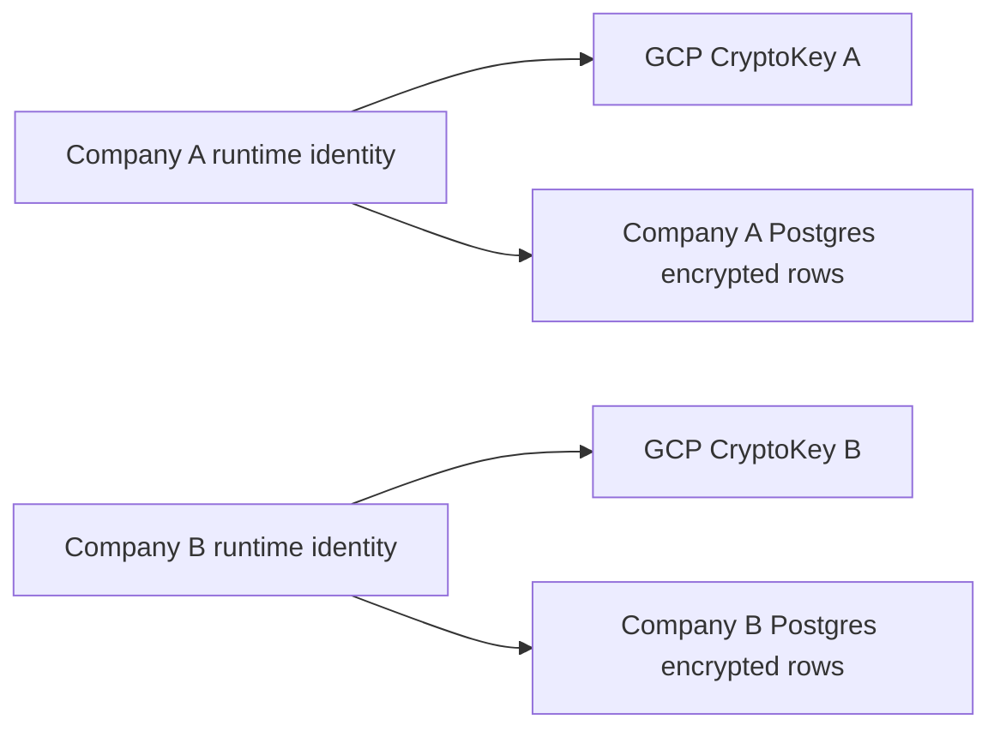

# GCP KMS-protected credential storage

`@sanoma-ai/workflows/kms-secrets` implements the proposed managed Cloud store for #470. Encrypted credentials live in **Postgres**, in `sanoma_kms.secrets` in the company database supplied by trusted bootstrap. Supabase can host that Postgres database; no separate key-value database is needed. GCP KMS protects encryption keys, not the credential records. BYOC Supabase Vault is a separate adapter. AWS Secrets Manager remains deferred.

## Runtime boundary

One company runs in one process with its own database authority and **GCP identity permitted to use only that company's CryptoKeys**. Trusted deployment bootstrap supplies the fixed company ID, CryptoKey resource name, SDK client and database connection. Never give company code fleet-wide decrypt authority or an administrator database connection. A company's code and installed connectors can use its authorized credentials; encryption does not protect those credentials from its own compromised runtime.

The proposed default is one symmetric SOFTWARE CryptoKey per company and environment, with keys grouped in a shared environment key ring/project. HSM protection is an independent provisioning choice, with different pricing; per-company software keys do not imply HSM protection. Separate production and test identities, keys and databases.

This adapter is not a production Cloud deployment. D1 implementation is tracked in [#492](https://github.com/Sanoma-AI/sanoma/issues/492) and [PR #496](https://github.com/Sanoma-AI/sanoma/pull/496). Isolated live IAM tests have passed; intended-host deployment and rollout checks remain separate. A Cloudflare deployment does not automatically have a Google identity. Workload Identity Federation or another approved refreshable credential route must bind the authenticated workload to its company; tenant code cannot select or impersonate other companies. The adapter provisions no identities, keys, database grants or shared service.

```ts
import { KeyManagementServiceClient } from "@google-cloud/kms";
import { KMS_SECRETS_SQL, kmsPostgresStore } from "@sanoma-ai/workflows/kms-secrets";

// Privileged deployment setup, once per company database:
await adminDb.query(KMS_SECRETS_SQL);
// Grant runtime USAGE on sanoma_kms and SELECT/INSERT/UPDATE/DELETE on sanoma_kms.secrets.

// Supply the company-scoped refreshable auth client from trusted bootstrap.
// D1 provides cloudIdentityAuth in the separate /cloud-identity entry once released.
const kms = new KeyManagementServiceClient({ authClient: companyAuthClient });
const store = kmsPostgresStore({
  company: companyIdFromTrustedBootstrap,
  keyName: "projects/cloud-project/locations/us-central1/keyRings/production/cryptoKeys/company-id",
  kms,
  database: async () => companyDatabase,
});
await store.validate("production");
// Deployment config: secrets: { store, namespace: "production" }
```

The caller owns client/database lifecycle, including `kms.close()`. `SANOMA_SIGNING_KEY` stays independent. This store does not use `SANOMA_SECRETS_KEY`. Workflow code cannot import this backend entry. Secret intake must remain outside durable workflow inputs/outputs.

## One shared key versus a key per company

| Event                                                   | One shared CryptoKey                                                                                                        | Per-company CryptoKeys with scoped identities                                                                 |
| ------------------------------------------------------- | --------------------------------------------------------------------------------------------------------------------------- | ------------------------------------------------------------------------------------------------------------- |
| Database backup stolen without KMS authority            | Encrypted credentials remain protected                                                                                      | Same protection                                                                                               |
| Company A runtime identity compromised                  | If it can call the shared key directly, that grant also authorizes decryption of B's ciphertext when available with its AAD | A's key grant cannot decrypt B's ciphertext under B's key                                                     |
| Fleet decrypt identity or IAM administrator compromised | Fleet exposure                                                                                                              | Fleet exposure still possible; separate keys cannot fix broad credentials or an attacker able to grant access |
| Disable a company or respond to an incident             | Key disable affects everyone; tenant access needs a broker/policy boundary                                                  | Revoke the company's identity or disable its key versions independently                                       |
| Destroy keys after retention ends                       | Shared key versions cannot be destroyed while any company still needs them                                                  | Independent company retention; all versions/copies/backups must be accounted for                              |
| Rotation and audits                                     | Shared lifecycle; attribution relies on identities and application records                                                  | Separate key lifecycle and key resource in audit events; configure appropriate audit logging                  |



A shared key can be safe behind a trusted broker that independently authorizes every company request and keeps shared-key permission out of company runtimes. That broker is a different architecture and is not implemented here. In the direct-runtime design, use per-company CryptoKeys and grant `roles/cloudkms.cryptoKeyEncrypterDecrypter` on those keys only. Avoid inherited project/key-ring grants and permissions to change IAM or impersonate other identities. [GCP IAM](https://cloud.google.com/kms/docs/iam) defines these resource boundaries.

GCP additional authenticated data (AAD) protects ciphertext binding; it is **not tenant authorization**. Unlike an AWS policy conditioned on encryption context, this GCP design does not claim an IAM restriction on the company string in AAD. A caller with permission to decrypt a shared key can supply another company's known AAD. See [GCP AAD](https://cloud.google.com/kms/docs/additional-authenticated-data).

`validate` checks an own-key encryption/decryption round trip and database schema access. It cannot certify that the identity lacks permission on every other company's key. Deployment evidence must inspect grants and prove cross-company denial using existing keys, including inherited permissions. The live test checks encrypt/decrypt denial in both directions between two test identities.

The database login must separately prevent cross-company access. The company column and key allowlist are defense in depth, not a replacement for database permissions or IAM. The SQL installer uses a private schema and removes public/API-role grants; never expose it through a browser Data API. Keep database/SDK payloads and credentials out of tracing and logs.

## Envelope format and rotation

Each independent secret or atomic token bundle occupies one row. `sanoma-gcp-kms-v1` generates a fresh random 256-bit data key locally for each write attempt. AES-256-GCM encrypts the value; GCP `Encrypt` wraps only the data key using the CryptoKey's primary version. Postgres stores the ciphertext, nonce, tag, wrapped data key, CryptoKey and version names, and an opaque UUID revision for compare-and-swap updates.

Both GCP AAD and local AES-GCM bind company, namespace, path, row revision and format. AES-GCM also authenticates the returned CryptoKeyVersion name. Reads accept only configured CryptoKeys. RPCs send CRC32C checksums and verify response integrity, including the version resource returned by encryption. Provider errors become sanitized store error codes. See Google's [encryption API](https://cloud.google.com/kms/docs/reference/rest/v1/projects.locations.keyRings.cryptoKeys/encrypt) and [integrity guidance](https://cloud.google.com/kms/docs/data-integrity-guidelines).

Values larger than 65,536 UTF-8 bytes are rejected. No plaintext or data-key cache is kept. Temporary mutable key buffers are cleared in `finally`; JavaScript strings and SDK-internal copies cannot be guaranteed erased. CAS conflicts leave committed values intact. Deleting a row does not revoke its vendor token or erase copies in backups.

There are three different rotations:

- **KMS version rotation:** a new primary version under the same CryptoKey. After the primary change propagates, new writes use it; existing rows still decrypt through their original enabled versions, without configuration changes. Automatic rotation does not rewrite old rows.
- **CryptoKey replacement:** change `keyName` and retain old company keys in `decryptKeyNames`. Read and rewrite old rows with their expected versions; conflict means reread rather than overwrite. This draft supports those primitives, not an automatic migration worker. Backups may still need the old keys.
- **Vendor credential rotation:** obtain a new API key or refresh an OAuth token, then save the new value. KMS rotation does not rotate vendor credentials or remove a compromised runtime's access.

Recovery needs database backups plus every enabled key version needed by retained envelopes. Test restores before retiring keys. Rewriting current rows is insufficient if retained backups contain old envelopes. Disabling is reversible but makes dependent ciphertext unreadable; destruction is irreversible after the provider's destruction window. AAD/version binding detects substitution, but does not prevent an authorized database writer from rolling back a complete old valid row; CAS assumes trusted database state. [GCP rotation](https://cloud.google.com/kms/docs/key-rotation).

## Rotation costs

GCP bills retained key **versions**, not just logical keys. Current list pricing is about $0.06 per SOFTWARE symmetric version per month, or $1 per HSM symmetric version; encrypt/decrypt operations cost $0.03 per 10,000. Creating a rotation is free. Enabled, disabled and scheduled-for-destruction versions all count until destroyed; partial months are prorated. [GCP pricing](https://cloud.google.com/kms/pricing).

| Retained versions per key | One shared SOFTWARE key | 1,000 company SOFTWARE keys | 1,000 company HSM keys |
| ------------------------- | ----------------------: | --------------------------: | ---------------------: |
| 1                         |             $0.06/month |                   $60/month |           $1,000/month |
| 2                         |             $0.12/month |                  $120/month |           $2,000/month |
| 5                         |             $0.30/month |                  $300/month |           $5,000/month |

These examples exclude operations, database costs, free-tier eligibility and replicas. One million symmetric KMS operations adds $3. Each store write attempt uses one encryption operation; each successful credential read requires one decryption. Validation uses both. Rewriting an existing row uses a read plus a write, so two operations before retries: $6 per million rows, plus database/compute work. A future data-key rewrap also requires decrypt/encrypt calls but is not implemented. Five retained versions could mean an initial version plus four rotations; this is an example, not a retention recommendation. Retention follows credential and backup recovery requirements.

## Verification

Focused tests use real local Postgres and AES-GCM with a GCP transport/IAM model. They cover atomic store conformance, tampering, checksums, key revocation, key replacement, primary-version rotation and restoration of old rows. They explicitly show that AAD cannot substitute for IAM.

The opt-in live suite requires two pre-provisioned test CryptoKeys and separate identities, each authorized only on its own key. Configure `SANOMA_GCP_KMS_LIVE=1`, `SANOMA_GCP_KMS_LIVE_KEY`, `SANOMA_GCP_KMS_LIVE_OTHER_KEY`, `SANOMA_GCP_KMS_LIVE_CREDENTIALS` and `SANOMA_GCP_KMS_LIVE_OTHER_CREDENTIALS`; the latter two name ignored SDK credential/federation configuration files. Use the isolated `SANOMA_TEST_DATABASE_URL` and run `pnpm vitest run packages/workflows/test/kms-secrets-live.test.ts`.

The suite creates no cloud resources and cleans only its own synthetic Postgres rows. Its positive checks prevent nonexistent/disabled keys from masquerading as an isolation proof. Local modeled tests do not establish real IAM isolation.

Live verification on `sanoma-513217` passed at `c3c293d0bc48cbcf66adf8e0cb0c57f500e686bc`: store conformance and two-way encrypt/decrypt denial between two existing company keys under distinct scoped identities. A separate run also proved production/preview denial in both directions. Positive own-key operations passed before each negative check. The local SDK used explicit service-account impersonation through the administrator’s OAuth session, with no service-account private keys. A separate temporary Cloud Run broker proof exercised the SDK/store against remote company databases, cross-key denials and KMS primary-version rotation: old ciphertext remained readable and new writes adopted the new primary after propagation. These are isolated synthetic resources, not a managed-hosting rollout; runtime renewal and production deployment evidence belong to D1.
